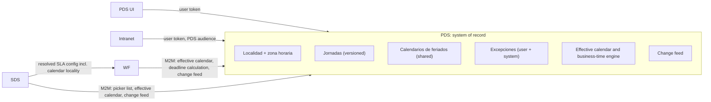
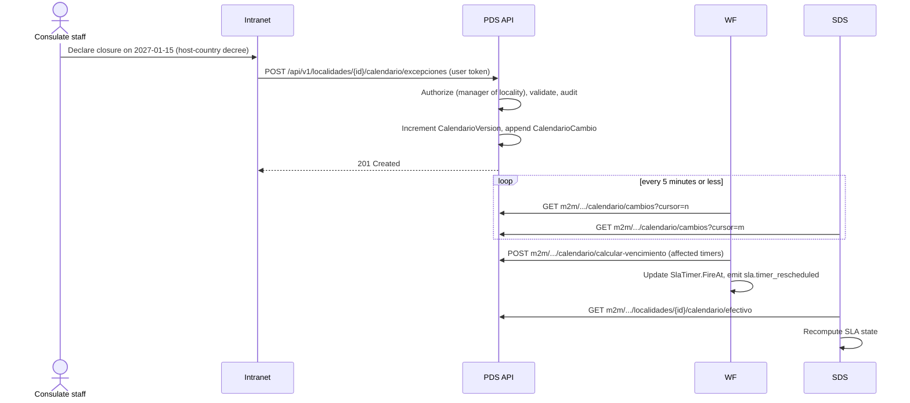
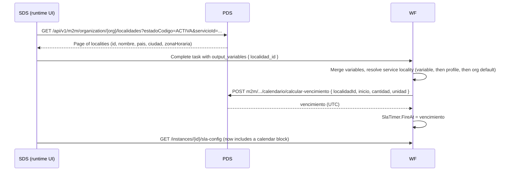
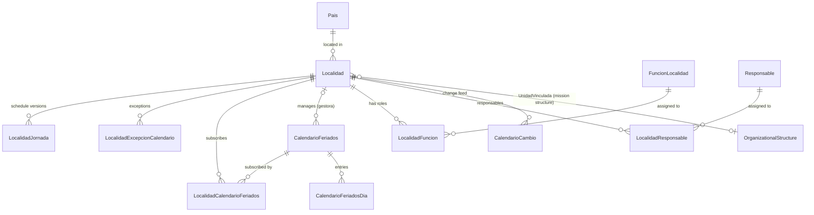

# SPEC-LOC-CAL-01: Locality time zones, working calendars and foreign-service roles

| | |
|---|---|
| **Status** | Draft v0.3, for review |
| **Date** | 2026-10-07 |
| **Primary system** | PDS (`PDS-BackEnd`, `PDS-FrontEnd`) |
| **Integrated systems** | WF (`WF-BackEnd`), SDS, institutional intranet |
| **Audience** | Senior developers and AI coding agents |
| **Canonical location** | `PDS-BackEnd/docs/specs/localities-time-zones-calendars.md` |

> **Language and naming.** This document is in English. The PDS `Localidad` module uses Spanish identifiers (`Localidad`, `NombreOficial`, `RF-LO-xx`). The new types, columns, routes and JSON properties proposed here keep that convention so the module stays uniform. §3 gives the English meaning of every term.

## How to use this spec

- **Normative words.** MUST, SHOULD and MAY follow RFC 2119. Priorities: **MUST** blocks its milestone; **SHOULD** is expected unless the PR records why not; **COULD** is optional.
- **Identifiers.**
  - `RF-LO-17` to `RF-LO-52` continue the series already cited in code comments (`RF-LO-01` to `RF-LO-16`; the highest found in the code is RF-LO-16). If the original requirements catalog already uses these numbers, renumber before implementation.
  - `WF-PDS-*`, `SDS-PDS-*` (continuing the existing `SDS-PDS-001`) and `INT-PDS-*` are cross-system requirements.
  - `RNF-LO-*` are non-functional requirements, `QA-PICK-*` QA scenarios, `D*` decisions, `OQ-*` open questions, `K-*` known issues.
- **For AI agents.**
  - Implement milestone by milestone (§15.2). Never start a milestone whose dependencies are not merged.
  - Every acceptance criterion (AC) is a test to write or a check to run.
  - Cite requirement IDs in code comments, test names and PR titles, as the module already does (`// RF-LO-15: …`).
  - When the code contradicts this spec, do not improvise. Record the conflict in §17. Implement the stated default only if it sits behind a constant or setting that can be changed later.

## Contents

1. [Introduction](#1-introduction)
2. [Current state](#2-current-state)
3. [Glossary](#3-glossary)
4. [Decisions](#4-decisions)
5. [Solution overview](#5-solution-overview)
6. [Functional requirements (PDS)](#6-functional-requirements-pds)
7. [Integration requirements (WF, SDS, intranet)](#7-integration-requirements-wf-sds-intranet)
8. [Non-functional requirements](#8-non-functional-requirements)
9. [Data design](#9-data-design)
10. [Rules and algorithms](#10-rules-and-algorithms)
11. [API contracts](#11-api-contracts)
12. [User interfaces (PDS)](#12-user-interfaces-pds)
13. [Migration and rollout](#13-migration-and-rollout)
14. [Verification](#14-verification)
15. [Implementation guide](#15-implementation-guide)
16. [Risks](#16-risks)
17. [Open questions](#17-open-questions)
- [Appendix A: Originating request](#appendix-a-originating-request)
- [Appendix B: Conformance vectors](#appendix-b-conformance-vectors)
- [Appendix C: Seeds, settings and permissions](#appendix-c-seeds-settings-and-permissions)
- [Appendix D: Known issues found during analysis](#appendix-d-known-issues-found-during-analysis)
- [Change log](#change-log)

---

## 1. Introduction

### 1.1 Purpose

PDS is the system of record for the institution's organizational structure and its localities: the Sede Central (headquarters), regional and municipal offices, service points and, with this spec, embassies, permanent missions and consulates. This spec makes PDS also the system of record for **when** each locality works: its time zone, its recurring working schedule and its non-working days. It defines the PDS changes, and the contracts through which other systems use that information.

The work has two parts, as in the originating request (Appendix A):

1. **Locality capabilities in PDS.** Time zone; working calendar (recurring working days first, then holidays and non-working days); foreign-service roles; end-to-end validation of the locality selection workflow.
2. **Use of that information by other systems.** WF and SDS compute SLA deadlines for services delivered in localities with different time zones and calendars. The intranet lets locality staff record holidays, or closures decided by the host country or by the Dominican Republic, without entering PDS.

### 1.2 Goal

> Any system that needs to know whether a locality is working at a given moment, or how much working time lies between two moments, gets one authoritative and auditable answer from PDS, expressed in that locality's own time zone and calendar.

### 1.3 Objectives

| ID | Objective | Delivered by |
|---|---|---|
| O1 | Every locality has an IANA time zone, and its current UTC offset, including daylight-saving changes, can be queried by API. | RF-LO-20 to 23 |
| O2 | Every locality, the Sede Central included, has an effective working calendar built from a recurring weekly schedule, shared holiday calendars and locality-specific exceptions. | RF-LO-24 to 36, 47 to 49 |
| O3 | Locality staff maintain non-working days from outside PDS (the intranet) through the PDS API, under authorization enforced by PDS. | RF-LO-37 to 44, INT-PDS-* |
| O4 | WF and SDS compute SLA deadlines in business time with the service locality's calendar and time zone, and WF's own calendar store is retired. | RF-LO-34, 35, 43; WF-PDS-*; SDS-PDS-* |
| O5 | Embassies, permanent missions, consulates general and embassies with consular sections are registered as localities with their roles, without adding an organizational structure inside localities. | RF-LO-17 to 19, 45, 46 |
| O6 | The locality selection workflow (SDS-PDS-001) lists every active locality, assigns tasks by locality, and is verified end to end; the PDS endpoints it uses are tenant-safe. | QA-PICK-*, RF-LO-51, RF-LO-52, SDS-PDS-002, 006, 007 |

### 1.4 Scope

**In scope**

- PDS backend and frontend: the data model, API, UI, migrations and seeds described here.
- Contracts that WF, SDS and the intranet consume, plus the WF changes needed to retire WF calendars and make SLA timers calendar-aware.
- An end-to-end QA plan for the locality selection workflow.
- Security hardening of the PDS endpoints that this workflow already uses.

**Out of scope**

- Organizational structures owned by a locality (possible future extension, D5).
- Consular jurisdictions abroad (`LocalidadCoberturaTerritorial` stays Dominican-only).
- Rule-based holiday generation (Easter-based dates, holidays moved under Dominican Law 139-97). Entries are loaded as concrete dates.
- Reminders to load next year's holidays (future).
- WF's critical-path estimate (`SlaPathCalculator`), which keeps normalized minutes (WF-PDS-008).
- The intranet's own UI and SDS internals. Only their contracts are specified.
- A per-step service locality in WF. Version 1 resolves one service locality per process instance (D12).
- Display time-zone preferences of individual users.
- General permission checks on locality CRUD (K-4). Only the new sensitive fields are guarded here.
- Restricting which localities offer each service (D16). When this is picked up, link PDS `Servicio` to SDS services by SDS `Service.Code` (or the 3-letter `PublicServiceCode`); not `DisplayCode`, which numbers individual requests.
- Calendar-aware assignment (skipping candidates whose locality is closed today). Possible future work.

### 1.5 Success measures

| Measure | Target |
|---|---|
| Active localities with a valid time zone and a weekly schedule | 100% at go-live of LOC-M2 |
| Active localities subscribed to at least one holiday calendar | 100% at go-live of LOC-M2 |
| Subscribed holiday calendars with entries for next year | 100% by 1 December each year (operational KPI) |
| Appendix B vectors passing in PDS and WF (and SDS, SDS-PDS-004) | 100% |
| Time from a calendar change in PDS to rescheduled WF timers | ≤ 15 min p95 |
| SDS calls to WF calendar endpoints after the sunset date | 0 |

### 1.6 Originating request and coverage

| # | Request item (translated) | Covered by |
|---|---|---|
| R1 | Tests of the locality selection workflow | §14.3 (QA-PICK-*), RF-LO-19, RF-LO-51 |
| R7 | SDS: consume `/m2m/organization/{organizationId}/locality` so the picker lists every available locality | RF-LO-52, SDS-PDS-002 |
| R8 | SDS: the assignment engine uses the lane's locality variable to select the candidate | SDS-PDS-007, WF-PDS-003 |
| R9 | SDS frontend: new design for the locality picker | SDS-PDS-006 |
| R10 | Decide where per-service locality limits live (WF, SDS or PDS) | Deferred (D16) |
| R2 | Let a time zone be set on the locality, honoring clock changes; endpoint returning a locality's current time zone | RF-LO-20 to 23 |
| R3 | Working days and holidays for every locality, Sede Central included. Recurring working weekdays first (not dates), then non-working days and holidays | RF-LO-24 to 33, RF-LO-48 |
| R4 | An endpoint so consulates and embassies can maintain non-working days without entering PDS, following each country's calendar and events | RF-LO-37 to 42, INT-PDS-* |
| R5 | Embassies, missions, consulates general and embassies with consular sections have a structure: assign these roles to the locality as it is, without adding a structure to localities | D5, RF-LO-45, RF-LO-46 |
| R6 | Use the information in other systems: SLA in WF across time zones; holiday and closure maintenance from the intranet for decisions of the host country or of the Dominican Republic | §7 |

---

## 2. Current state

### 2.1 PDS localities

- **Entity.** `Localidad` ([PDS.Domain/Models/Localidad.cs](../../PDS.Domain/Models/Localidad.cs)) is a site of the institution, scoped by `OrganizationId`. It has logical deletion (`DeletedAt`) and a lifecycle driven by `EstadoLocalidad` codes `ACTIVA`, `EN_APERTURA`, `SUSPENDIDA_TEMP`, `EN_CIERRE` and `INACTIVA`. All FKs use `DeleteBehavior.Restrict`. Tables live in schema `Organization`.
- **Links to the org chart.** A locality is not an org unit (RF-LO-02). It links optionally to units through `UnidadResponsableId`, `UnidadVinculadaId` and the N:M `LocalidadUnidadPresencia`.
- **Territory.** `PaisId` exists, but only `DO` is seeded ([PDS.Application/Seed/TerritorioRD.sql](../../PDS.Application/Seed/TerritorioRD.sql)). Region, province, municipality and municipal district are Dominican catalogs, and validation (`ValidateTerritorialAsync`) assumes the Dominican Republic.
- **Schedules.** `HorarioRegular` is free text (≤ 1000). `LocalidadHorarioExcepcion` holds `Descripcion`, `FechaInicio`, `FechaFin` and a free-text `Horario`. There is no time zone. None of this is machine-usable.
- **Responsables.** `Responsable` (per organization: `Nombre`, `Cargo`, `Email`, `Telefono`) has **no link to a GobID identity**. `LocalidadResponsable` is the N:M link (`Rol`, `Principal`).
- **Audit.** `LocalidadAuditoria` is append-only, with a JSON diff.
- **API.**
  - User endpoints: `/api/v1/localidades` (CRUD, lifecycle, sub-resources) and catalogs under `/api/v1/catalogos/...`.
  - M2M list: `GET /api/v1/m2m/organization/{organizationId}/localidades` in `M2MIntegrationController`.
  - Two absolute routes declared in `LocalidadesController`: `/m2m/organization/{organizationId}/locality` and `/m2m/localidades/by-ids`. Absolute action routes bypass the `api/v1` prefix that `ApiPrefixConvention` adds to controller routes (verify in Scalar).
- **Authorization.**
  - Locality endpoints only carry `[Authorize]`; there are no permission checks.
  - M2M access relies on the `is_service_account` claim and the `access:M2M` permission.
  - User JWTs are validated against one audience (`Jwt:ValidAudience`) and the HS256 secret GobID issued to PDS ([PDS/Program.cs](../../PDS/Program.cs)).
- **Stack.** .NET 10, EF Core 10 on SQL Server, xUnit and Moq (EF InMemory/Sqlite for tests). Angular frontend. NodaTime is not referenced yet.

### 2.2 WF calendars and SLA timers

- **Calendar entity.** `WorkingCalendar` (WF-SLA-08) holds `WorkingDaysCsv`, one `StartTime`/`EndTime` pair for all days, an IANA `TimeZone`, `HolidaysJson` (ISO dates) and the organization. Its code comments call it the single source of working time and holidays for the ecosystem. SDS reads it, including `/holidays`, under WF-SLA-16.
- **Calendar API.** Endpoints live under `/api/internal/v1/sla/calendars`: `view:sla-config` to read, `manage:sla-config` to write.
- **Profiles.** `SlaProfile.CalendarBaseGuid` points to one WF calendar per profile. Nothing in WF knows which locality an instance serves.
- **Timers ignore calendars.** `ProcessRuntimeService.StartSlaTimerIfDefinedAsync` sets `FireAt = UtcNow + SlaVocabulary.ToMinutes(amount, unit)`, with `bizdays = 480 min` and `caldays = 1440 min`. Weekends, holidays, working hours and time zones are all ignored: a "3 bizdays" timer fires after 24 wall-clock hours.
- **SLA state.** SDS computes SLA state and pushes it to WF (WF-SLA-20). WF's resolved configuration (WF-SLA-15) exposes the profile but no calendar.

### 2.3 Locality selection workflow (SDS-PDS-001)

- **Step definition.** A `human_task` with `tool_binding.kind = "pds"` and an `operation_id` that points to a PDS locality-list operation in WF's tool registry.
- **Validation.** `WorkflowDefinitionValidator` raises `SEM_PDS_NO_OPERATION` when `operation_id` is empty.
- **Publish.** `ProcessDefinitionVersionService` resolves `endpoint_url` and `http_method` from the operation, so SDS can render the dropdown from that endpoint.
- **Selection.** The chosen locality returns to WF through the step's `output_variables`. No variable name is standardized.
- **SDS side (branch `development`, not `master`).** `PdsToolExperienceProvider` calls the PDS endpoint server-side with the runtime GobID M2M token, substituting `{organizationId}` from the instance variable `organization_id`. It sends no query parameters and reads only the response body, so it shows **only the first page (20 localities)** and includes suspended and closed localities (K-8). Both SDS frontends (`SDS-FrontOffice`, `SDS-FrontEnd`) render the options in a plain `<select>` (`pds-locality-step.component.ts`).
- **Assignment by locality (already built).** The WF designer (`WF-FrontEnd`, branch `development`) lets a lane set `assignment.assign_by_locality` and `assignment.locality_variable` (`$.variables.<name>`). SDS (`WfTaskAssignmentOrchestrator` and `GeographicFilter`) keeps only candidates whose locality, read from their GobID personnel record as a PDS locality GUID, equals the variable's value. When no candidate matches, the assignment engine escalates the task to a superior.

### 2.4 Gaps

| ID | Gap | Addressed by |
|---|---|---|
| G1 | Localities have no time zone | RF-LO-20 to 23 |
| G2 | Schedules and exceptions are free text, not computable | RF-LO-24 to 34, 47 |
| G3 | Only the Dominican Republic exists as a country; territorial validation is Dominican-specific | RF-LO-17, 18 |
| G4 | No way to say a locality is an embassy, mission or consulate | RF-LO-45, 46 |
| G5 | Two calendar stores (WF and, after this spec, PDS) would drift apart | D1, WF-PDS-007 |
| G6 | WF SLA timers ignore working days, holidays, hours and time zones | WF-PDS-003 to 005 |
| G7 | Responsables have no identity, so PDS cannot authorize locality staff | RF-LO-37, 38 |
| G8 | Any authenticated user of an organization can edit any of its localities (K-4) | RF-LO-37 to 39 for the new sensitive fields |
| G9 | M2M locality routes leak across tenants (K-1, K-2) | RF-LO-51 |
| G10 | Integrations must filter by environment-specific GUIDs (e.g., `estadoId`) | RF-LO-19 |
| G11 | The locality picker shows at most 20 localities, including suspended and closed ones | RF-LO-52, SDS-PDS-002 |
| G12 | Lane assignment and SLA would each configure their own locality variable | D15, WF-PDS-003, SDS-PDS-007 |
| G13 | The picker's plain dropdown cannot handle hundreds of localities or show country and city | SDS-PDS-006 |

---

## 3. Glossary

| Term (code) | Meaning |
|---|---|
| Localidad | A physical, territorial or operational site of the institution |
| Sede Central | Headquarters, a `Localidad` whose `TipoLocalidad` is `SEDE_CENTRAL` |
| Zona horaria | IANA time-zone ID, such as `America/New_York`. Never a fixed offset |
| Desplazamiento UTC | UTC offset in force at an instant, derived from the TZDB |
| Horario de verano | Daylight-saving time (DST) |
| Jornada | Recurring weekly working schedule: working intervals per weekday |
| Intervalo laboral | `[inicio, fin)` in local wall-clock time, as minutes from local midnight |
| Versión de jornada | A schedule in force from `vigenteDesde` until the next version starts |
| Calendario de feriados | A shared, reusable set of dated non-working days (e.g., Spanish national holidays) |
| Feriado (entrada) | One dated entry of a holiday calendar: full day or reduced hours |
| Suscripción | A locality's use of a holiday calendar, optionally bounded in time |
| Excepción | A locality-specific dated rule: closure, special hours or additional working day |
| Excepción de sistema | An exception PDS creates from a lifecycle event (suspension, closure) |
| Calendario efectivo | The resolved working status and intervals of each day for one locality |
| Tiempo laborable | Business time: time that falls inside the effective calendar's working intervals |
| Localidad de servicio | The locality whose calendar governs a process instance's SLA |
| Localidad predeterminada | The organization's fallback calendar locality, normally the Sede Central |
| Gestor de calendario | Calendar manager: a responsable delegated to maintain a locality's calendar (RF-LO-38) |
| Función de localidad | Foreign-service role of a locality: embassy, permanent mission, consulate general, consular section |
| País anfitrión / país propio | Host country / home country (the Dominican Republic) |
| TZDB | The IANA time-zone database, here as embedded in NodaTime |

---

## 4. Decisions

| ID | Decision | Rationale and consequences |
|---|---|---|
| D1 | **PDS is the single store of working calendars. WF's `WorkingCalendar` is retired in phases.** *(Confirmed by the requester, 2026-10-07.)* | Avoids two diverging sources. WF and SDS read PDS (WF-PDS-*, SDS-PDS-*). WF calendar endpoints become a deprecated facade, then disappear (WF-PDS-007). |
| D2 | **Layered calendar.** Weekly schedule per locality (versioned) + shared holiday calendars per organization, subscribed by localities + locality exceptions. *(Confirmed.)* | An embassy and its consulates in one country share host-country holidays, entered once. Local administrative decisions stay local. |
| D3 | **Locality staff rights are data-driven.** A user manages a locality's calendar when their GobID user is linked to an active `LocalidadResponsable` of that locality with `GestionaCalendario = true`. Central admins hold `localities:calendar:manage`. *(Confirmed; the `GestionaCalendario` flag is a refinement, so that not every responsable can edit.)* | Reuses an existing concept. Requires a GobID link on `Responsable` and protecting both fields against self-escalation (K-4). |
| D4 | **Time zones are IANA IDs evaluated with NodaTime's embedded TZDB. Offsets are never stored.** | DST and historical rule changes are handled by the TZDB. Results are identical on Windows and Linux, and the TZDB version is explicit (`tzdbVersion`). |
| D5 | **No organizational structure inside localities.** Foreign-service roles are a multi-valued classification (`FuncionLocalidad`); a mission's structure is the org-chart unit linked through `UnidadVinculadaId`. *(Requester's proposal.)* | Keeps the existing principle "a locality is not an org unit" (RF-LO-02). "Embassy with consular section" = {`EMBAJADA`, `SECCION_CONSULAR`}. Locality-owned structures stay a future option. |
| D6 | **Business-time arithmetic is specified once (§10.3) and implemented in PDS as the reference** (pure engine plus endpoints). | Consumers call PDS, or prove conformance with Appendix B. |
| D7 | **Change propagation is pull-based:** a monotonic `CalendarioVersion` per locality and a change feed. No webhooks in v1. | Simple, idempotent, no inbound connectivity needed from PDS to consumers. |
| D8 | **Lifecycle events become system exceptions.** | Reactivation clears the suspension fields on `Localidad`. A system exception preserves the history needed to recompute past SLAs. |
| D9 | **The locality selection workflow is validated with an end-to-end manual QA plan**, with no new automated tests for the picker itself. *(Confirmed.)* | §14.3. New PDS capabilities still require automated tests (§14.1). |
| D10 | **`HorarioRegular` remains an informational note. `LocalidadHorarioExcepcion` is migrated and frozen.** | Free text cannot be parsed safely. The structured schedule is authoritative. |
| D11 | **Holiday calendars are tenant-scoped (`OrganizationId`)**, like `Servicio` and `Responsable`. | Observed holidays may differ by institution. |
| D12 | **One service locality per process instance in v1** (resolution: instance variable, then SLA profile, then organization default). | Covers "service delivered at locality X". Per-step localities (e.g., a step done at headquarters) are future work (OQ-10). |
| D13 | **The M2M locality list returns every matching locality in one response, with no paging.** Soft-deleted localities are never returned. *(Confirmed, 2026-10-07.)* | The picker must offer all localities; the catalog is small (hundreds). The PDS UI list keeps paging. |
| D14 | **Assignment by locality keeps today's behavior:** exact match between the selected locality and the candidate's locality; when nobody matches, the assignment engine escalates to a superior; each staff member belongs to exactly one locality. *(Confirmed.)* | No hierarchy, alternate-locality or multi-locality rules are needed. |
| D15 | **One service-locality variable per process,** shared by SLA calendars and lane assignment; a lane may override it for assignment. *(Confirmed.)* | Avoids two settings drifting apart. Replaces the separate `sla.locality_variable` idea. |
| D16 | **Which localities offer each service is out of scope for now.** *(Confirmed.)* | The picker lists every active locality of the organization. PDS's existing `servicioId` filter stays available but no integration uses it. |

---

## 5. Solution overview

### 5.1 Context



### 5.2 Calendar layers

For one locality and one local date, the first matching layer decides (full algorithm in §10.2):

1. **Lifecycle:** before `FechaApertura`, or covered by a system exception (suspension, definitive closure). Non-working.
2. **Locality exception** (user): closure, special hours or additional working day.
3. **Holiday entries** from subscribed calendars: full day, so non-working; or reduced hours, so the day is limited to the given window.
4. **Weekly schedule** in force on that date: the weekday's intervals, or non-working if none.

### 5.3 Key flows

**Closure declared from the intranet, then WF timers rescheduled.**



**Locality picker, then calendar-aware SLA.**



---

## 6. Functional requirements (PDS)

### 6.1 Countries and localities abroad

#### RF-LO-17: World country catalog (MUST)

PDS MUST hold every ISO 3166-1 country so that localities abroad can be registered.

- Seed all ISO 3166-1 entries into `Organization.Paises`. `Codigo` is the alpha-2 code; the existing `DO` row keeps its `Id`. `Nombre` is in Spanish. Add a nullable `CodigoIso3`.
- The seed is an embedded, idempotent SQL script (`PDS.Application/Seed/PaisesISO3166.sql`, `IF NOT EXISTS … WHERE [Codigo] = …`), following `TerritorioRD.sql`.
- `GET /api/v1/territorio/paises` returns `id`, `codigo` and `nombre` for all countries, ordered by `nombre`.

Acceptance criteria:
- AC1: After migration, `Paises` holds at least 249 rows, the `DO` row keeps its `Id`, and re-running the script inserts nothing.
- AC2: Existing localities and Dominican territorial rows are unaffected (FKs intact).

#### RF-LO-18: Addresses abroad and territorial consistency (MUST)

- Add optional `Localidad.Ciudad` (≤ 150) and `Localidad.SubdivisionAdministrativa` (≤ 150: state, province or region abroad).
- When `PaisId` is not the Dominican Republic, `RegionId`, `ProvinciaId`, `MunicipioId` and `DistritoMunicipalId` MUST be null, and `Ciudad` MUST be provided.
- When Dominican territorial IDs are given, their country MUST equal `PaisId` (extend `ValidateTerritorialAsync`).
- Duplicate scan (RF-LO-13): for localities abroad, the `provinciaMunicipioTipo` rule becomes `paisCiudadTipo`: same `PaisId`, same `Ciudad` (case-insensitive) and same `TipoLocalidadId`.

Acceptance criteria:
- AC1: Creating a locality with `PaisId` = Spain and a Dominican `ProvinciaId` returns 400 with error key `territorio`.
- AC2: Creating a locality abroad without `Ciudad` returns 400 with key `ciudad`.
- AC3: A second active locality with the same country, city and type triggers duplicate warning `paisCiudadTipo`, which can be overridden with a justification, as today.

#### RF-LO-19: Fields and stable filters for consumers (MUST)

- `LocalidadListItemDto` (UI list, M2M list, `by-ids`) adds `paisId`, `paisCodigo`, `paisNombre`, `ciudad`, `zonaHoraria`, `estadoCodigo` and `funciones` (codes).
- `LocalidadFilterDto` adds `paisId`, `paisCodigo`, `estadoCodigo`, `funcionId` and `funcionCodigo`. Code-based filters exist so integrations, such as the SDS-PDS-001 tool-registry operation, never embed environment-specific GUIDs.

Acceptance criteria:
- AC1: `GET /api/v1/m2m/organization/1/localidades?estadoCodigo=ACTIVA&paisCodigo=US&funcionCodigo=CONSULADO_GENERAL` returns only active consulates general in the United States.
- AC2: Existing callers that send none of the new parameters get the same items as before (fields are additive).

### 6.2 Time zone

#### RF-LO-20: Locality time zone (MUST)

- Add `Localidad.ZonaHoraria` (`nvarchar(64)`): an IANA ID such as `America/New_York`. Required on create and update.
- An ID is valid if it exists in the TZDB bundled with NodaTime (`DateTimeZoneProviders.Tzdb.GetZoneOrNull(id) != null`). Windows IDs (e.g., `SA Western Standard Time`) are rejected with a hint giving the IANA equivalent when one exists (`TimeZoneInfo.TryConvertWindowsIdToIanaId`).
- Offsets are never stored. They are derived from the TZDB at query time, so DST transitions follow the TZDB rules.
- Changing `ZonaHoraria` requires `localities:calendar:manage` (403 otherwise). The change is recorded in the audit diff (`zonaHoraria`), increments `CalendarioVersion` and appends a change-feed row (RF-LO-43).
- Migration backfills `America/Santo_Domingo` for every Dominican locality, then makes the column NOT NULL.

Acceptance criteria:
- AC1: `America/New_York` is accepted and returned by detail and list.
- AC2: `Eastern Standard Time` returns 400 with key `zonaHoraria`; the message suggests `America/New_York`.
- AC3: `Mars/Olympus` returns 400 with key `zonaHoraria`.
- AC4: A user without `localities:calendar:manage` who changes `zonaHoraria` gets 403 with key `permiso`. The same update without a time-zone change still succeeds (no regression).

#### RF-LO-21: Time-zone catalog (MUST)

- `GET /api/v1/catalogos/zonas-horarias?paisCodigo={ISO2}` lists the canonical zones the TZDB associates with the country (NodaTime `TzdbDateTimeZoneSource.Default.ZoneLocations`).
- Each item has `id`, `comentario` (TZDB comment, e.g., "Eastern (most areas)"), `desplazamientoActual` and `esHorarioVeranoActual`.
- Without `paisCodigo`, all canonical zones are returned.

Acceptance criteria:
- AC1: `paisCodigo=DO` returns exactly `America/Santo_Domingo`.
- AC2: `paisCodigo=ES` returns `Europe/Madrid`, `Africa/Ceuta` and `Atlantic/Canary`.
- AC3: `paisCodigo=US` includes `America/New_York` and `America/Los_Angeles`.

#### RF-LO-22: Current time zone of a locality (MUST)

This is the endpoint explicitly requested in R2.

- User endpoints: `GET /api/v1/localidades/{id}/zona-horaria[?instante=…]` and the batch `GET /api/v1/localidades/zona-horaria?ids=…` (≤ 200 IDs).
- M2M: the same paths under `/api/v1/m2m/organization/{organizationId}/`, with the permissions of RF-LO-39.
- `instante` (UTC, ISO 8601) defaults to now, from an injected `TimeProvider`.
- Response (§11.3.1): `zonaHoraria`, `instante`, `fechaHoraLocal`, `fechaLocal`, `desplazamientoUtc` (e.g., `-04:00`), `desplazamientoMinutos`, `esHorarioVerano`, `abreviatura` (e.g., `EDT`, from the TZDB interval name), `proximaTransicion` (`{instante, desplazamientoUtc, esHorarioVerano}` or `null`) and `tzdbVersion`.

Acceptance criteria: vectors TZ-01 to TZ-04 (Appendix B).

#### RF-LO-23: Locality-local dates (MUST for new code, SHOULD for existing defaults)

- Every date a user perceives as "today" for a locality (default dates, the retroactive window of RF-LO-33, `estado` queries) MUST be computed in the locality's time zone from an injected `TimeProvider`. It is never taken from the server clock or the UTC date.
- Existing defaults in `LocalidadService` that use `DateOnly.FromDateTime(DateTime.UtcNow)` (suspension start, closure date, service and responsable assignment dates) SHOULD switch to the locality-local date.

Acceptance criteria:
- AC1: For a locality in `Asia/Tokyo` at `2026-10-07T20:00:00Z`, the local date is `2026-10-08` (TZ-04).

### 6.3 Weekly schedule

#### RF-LO-24: Recurring weekly schedule (MUST)

- Each locality has a weekly schedule. For each weekday (`mon` to `sun`) it has 0 to 4 working intervals `[inicio, fin)` in local wall-clock time (`"HH:mm"`; `fin` may be `"24:00"`). A weekday with no interval is non-working.
- Rules: `inicio` < `fin`; intervals within one day do not overlap; the week has at least one interval; intervals do not cross midnight (split them across days).
- The UI collects the schedule **first**, and as **weekdays, not dates** (e.g., "every day except Sunday, 08:00 to 16:00"). Non-working dates come afterwards, through holidays and exceptions (RF-LO-48).

Acceptance criteria:
- AC1: "Every day except Sunday, 08:00 to 16:00" is stored as `mon` to `sat` = `[08:00–16:00]` and `sun` = `[]`.
- AC2: Overlapping intervals (`08:00–12:00` and `11:00–14:00`) return 400 with key `jornada`.
- AC3: A week without intervals returns 400 with key `jornada`.

#### RF-LO-25: Schedule versions (MUST)

- A schedule change creates a new version with `vigenteDesde` (local date). The version in force on date *d* is the one with the greatest `vigenteDesde` ≤ *d*. Versions already in force are immutable, so a new version never rewrites history.
- Calendar managers who are not admins can only create versions with `vigenteDesde` ≥ local today. Admins may backdate, with a mandatory `motivo`; the change is audited and published in the change feed with the affected range.
- A version not yet in force can be deleted.
- Migration creates, for each locality, an initial version with `vigenteDesde` = `2000-01-01` (§13.1).

Acceptance criteria:
- AC1: With version A (2000-01-01, Monday to Friday) and version B (2027-01-01, Monday to Saturday), 2026-12-31 resolves with A, and Saturday 2027-01-02 is a working day under B.
- AC2: A non-admin manager posting `vigenteDesde` = yesterday gets 403 with key `vigenteDesde`.
- AC3: Deleting a version already in force returns 409.

#### RF-LO-26: Presets and copying (SHOULD)

- The UI offers presets ("Lun–Vie 08:00–16:00", "Lun–Sáb", "Todos los días excepto domingo") and "Copiar de otra localidad".
- A locality created without a schedule receives a copy of the schedule in force at the default locality (RF-LO-36), with `vigenteDesde` = `FechaApertura` or local today.

Acceptance criteria:
- AC1: After creating a locality without a schedule, `GET …/calendario` returns one version equal to the default locality's current one.

### 6.4 Shared holiday calendars

#### RF-LO-27: Holiday calendar catalog (MUST)

- New per-organization catalog `CalendarioFeriados` with:
  - `codigo`: unique in the organization, e.g., `DO-NAC`, `DO-EXT`, `US-FED`, `ES-NAC`, `ES-MD`;
  - `nombre`, `descripcion`;
  - `paisId` (optional);
  - `ambito`: `Nacional`, `Subnacional`, `Local`, `Institucional` or `OrganismoInternacional`;
  - `localidadGestoraId` (optional): the locality whose calendar managers may maintain its entries;
  - `activo`.
- Calendars are soft-deleted. Deletion is refused (409, listing the subscribers) while any locality subscribes.

Acceptance criteria:
- AC1: A duplicate `codigo` in the same organization returns 400 with key `codigo`; the same code in another organization is accepted.
- AC2: Deleting a calendar that has subscribers returns 409 listing them.

#### RF-LO-28: Holiday entries (MUST)

- Entry fields: `fecha` (unique per calendar), `nombre`, `alcance` (`DiaCompleto` or `JornadaReducida`), `intervalos` (required only for `JornadaReducida`: the working window left that day), `referenciaNormativa` (optional, e.g., a decree number) and `notas`.
- Entries are concrete dates. PDS does not compute movable holidays (Easter-based, or moved under Law 139-97); they are entered each year as officially published.

Acceptance criteria:
- AC1: Two entries with the same date in one calendar return 409.
- AC2: `JornadaReducida` without intervals returns 400 with key `intervalos`.

#### RF-LO-29: Bulk loading (SHOULD for import, COULD for copy-year)

- `POST …/calendarios-feriados/{id}/dias/importar` accepts a JSON array and SHOULD also accept CSV (`fecha,nombre,alcance,intervalos,referenciaNormativa`).
  - `modo` is `agregar` or `reemplazarAnio`; `validarSolamente` performs a dry run.
  - The import is atomic and returns `{creados, actualizados, omitidos, errores[]}`, with the line number of each error.
- COULD: `POST …/dias/copiar-anio {anioOrigen, anioDestino}` copies entries keeping month and day, and returns them for review. Movable holidays must then be corrected by hand.

Acceptance criteria:
- AC1: An import with one invalid line and `validarSolamente=false` changes nothing and reports the line.

#### RF-LO-30: Subscriptions (MUST)

- A locality subscribes to 0 to n holiday calendars, each with optional `vigenteDesde` and `vigenteHasta` (e.g., a mission that moves city switches regional calendars).
- Typical setups:
  - a Dominican locality subscribes to `DO-NAC`;
  - the embassy in Madrid subscribes to `ES-NAC`, `ES-MD` (and the city's calendar if any) and `DO-EXT` (Dominican holidays observed abroad, OQ-04).
- The UI warns when a locality has no subscription.

Acceptance criteria:
- AC1: An entry in a subscribed calendar makes that date non-working for every subscriber in the effective calendar. Outside the subscription's validity it has no effect.

### 6.5 Locality exceptions

#### RF-LO-31: Locality exceptions (MUST)

- Fields:
  - `fechaInicio` and `fechaFin`: inclusive local dates, spanning at most 366 days;
  - `tipo`: `Cierre` (closure), `JornadaEspecial` (special hours) or `DiaLaborableAdicional` (additional working day);
  - `intervalos`: forbidden for `Cierre`, required for the other two types;
  - `categoria`: `DecisionAdministrativa`, `FeriadoLocal`, `DueloOficial`, `Emergencia`, `EventoInstitucional` or `Otro`;
  - `origen`: `PaisAnfitrion`, `PaisPropio` or `Institucional`;
  - `motivo` (required), `referenciaNormativa`, and `instrumentoLegalId` (optional FK to `LegalInstrument`).
- User exceptions of one locality MUST NOT overlap (409, naming the conflicting exception).
- Soft delete. Every change is audited (RF-LO-44).

Acceptance criteria:
- AC1: A closure from 2026-10-20 to 2026-10-21 with `origen = PaisAnfitrion` makes both days non-working in the effective calendar, with `fuente = Excepcion` and the `motivo` visible.
- AC2: A `DiaLaborableAdicional` on a Saturday with `09:00–13:00` makes that Saturday a working day.
- AC3: An overlapping exception returns 409 with key `solapamiento`.

#### RF-LO-32: Lifecycle exceptions (MUST)

- **Suspension** (RF-LO-09) creates a system exception (`esSistema = true`, `categoria = Suspension`, `tipo = Cierre`) from `SuspensionFechaInicio` to `SuspensionFechaFin`, open-ended if the end is null. **Reactivation** sets its `fechaFin` to the local day before the reactivation; the reactivation day itself follows the schedule.
- **Closure** (RF-LO-10) creates an open-ended system exception (`categoria = CierreDefinitivo`) starting on `CierreFecha`.
- **Before opening:** dates earlier than `FechaApertura` (when set) are non-working (`fuente = CicloVida`, computed, no row stored).
- System exceptions cannot be created, edited or deleted through the exception endpoints (403). They take precedence over user exceptions. Migration creates them for localities currently suspended or closed.

Acceptance criteria:
- AC1: Suspended from 2026-11-02 and reactivated on 2026-11-10: 2026-11-02 to 2026-11-09 are non-working (`CicloVida`), 2026-11-10 follows the schedule, and that history persists after reactivation.

#### RF-LO-33: Retroactive window (MUST)

- Calendar managers who are not admins may create, change or delete exceptions, holiday entries and subscriptions only if every affected date ≥ local today − *N* days (`Calendario:VentanaRetroactivaDias`, default 7; OQ-07).
- Admins have no window but MUST give a `motivo` for retroactive changes.
- Every retroactive change is published in the change feed with its date range, so SLA consumers can recompute (RF-LO-43).

Acceptance criteria:
- AC1: A manager adding a closure dated 10 days ago gets 403 with key `fechaInicio`. An admin doing the same without `motivo` gets 400.

### 6.6 Effective calendar and business time

#### RF-LO-34: Effective calendar (MUST)

- For a locality and a local date range of at most 400 days, PDS resolves each day following §10.2:
  - `laborable` (working or not);
  - `intervalos` (local) and `intervalosUtc`;
  - `fuente`: `Jornada`, `Feriado`, `Excepcion` or `CicloVida`;
  - `motivos`: holiday names, exception reasons and their IDs.
- Endpoints:
  - `GET /api/v1/localidades/{id}/calendario/efectivo?desde&hasta`, and the M2M equivalent;
  - SHOULD: `…/calendario/estado?instante=`, which returns whether the locality is working at that instant, the current interval and the next working instant.
- Responses carry `calendarioVersion`, `zonaHoraria` and `tzdbVersion`. The `ETag` is derived from `calendarioVersion` and the range.
- Consumers SHOULD use `intervalosUtc`, so they need no time-zone logic of their own.

Acceptance criteria: vectors EC-01 to EC-05 and ST-01 to ST-02 (Appendix B).

#### RF-LO-35: Business-time reference endpoints (SHOULD)

- M2M `POST …/calendario/calcular-vencimiento` with `{localidadId, inicio, cantidad, unidad}`, where `unidad` is one of `min`, `hours`, `bizdays`, `caldays` (WF vocabulary). It returns `{vencimiento, vencimientoLocal, zonaHoraria, calendarioVersion, convencion: "v1"}`.
- M2M `POST …/calendario/tiempo-laborable` with `{localidadId, desde, hasta}` returns `{minutosLaborables}`.
- Batch variants accept up to 100 items. Both endpoints run the pure engine of §10.3, the same code the unit tests exercise.

Acceptance criteria: vectors BT-01 to BT-13 (Appendix B).

#### RF-LO-36: Default calendar locality (MUST)

- Exactly one active locality per organization has `EsLocalidadCalendarioPredeterminada = true` (filtered unique index). It is the fallback calendar for consumers (WF-PDS-003) and the template for new localities (RF-LO-26).
- Migration sets it on the organization's active `SEDE_CENTRAL` locality. If there is not exactly one, an admin must choose before LOC-M4 (blocking).
- Admin endpoint `PUT /api/v1/localidades/{id}/calendario/predeterminada`; M2M `GET …/calendario/localidad-predeterminada`.

Acceptance criteria:
- AC1: Flagging a second locality moves the flag in one transaction; the previous locality loses it.

### 6.7 Authorization and delegation

#### RF-LO-37: Responsable linked to a GobID user (MUST)

- Add `Responsable.GobidUserId` (GUID, optional, unique per organization when set). It holds the GobID user ID (the token's `sub` claim).
- Only holders of `localities:calendar:manage` may set or change it, which prevents self-escalation (K-4).

Acceptance criteria:
- AC1: A user without the permission who sends `gobidUserId` gets 403. The same request without that field behaves as today.

#### RF-LO-38: Calendar manager delegation (MUST)

- Add `LocalidadResponsable.GestionaCalendario` (bool, default false). Only admins set it.
- A caller is a **calendar manager** of locality *L* if and only if:
  - an active `LocalidadResponsable(L, R)` has `GestionaCalendario = true`;
  - `R.GobidUserId` equals the token's `sub`;
  - `R` is not deleted and belongs to the token's organization;
  - *L* is not in a terminal state.
- A calendar manager of *L* may, always within RF-LO-33:
  - create future schedule versions of *L* and delete those not yet in force;
  - replace *L*'s subscriptions;
  - manage *L*'s user exceptions;
  - manage the entries (not the header, not deletion) of holiday calendars whose `localidadGestoraId` = *L*.

Acceptance criteria: the matrix in §10.4, as table-driven tests.

#### RF-LO-39: Permissions and guard (MUST)

- New constants in `PDS.Service/Authorization/LocalidadPermissions.cs`:
  - `localities:calendar:manage`: organization-wide calendar admin;
  - `localities:calendar:read`: M2M read, required in addition to `access:M2M`.
- Checks live in services through `ICalendarioAccessGuard`, mirroring `IPlanningAccessGuard` (explicit checks, not ASP.NET policies).
- New M2M calendar endpoints call `RequireM2MServiceAccountAsync(LocalidadPermissions.CalendarRead)`.

Acceptance criteria:
- AC1: An M2M token without `localities:calendar:read` gets 403 on calendar endpoints. The existing M2M locality list is unaffected.

#### RF-LO-40: What can I manage (MUST)

- `GET /api/v1/localidades/calendario/gestionables` returns the localities the caller manages: `id`, `codigo`, `nombreOficial`, `pais`, `ciudad`, `zonaHoraria`, and `rol` = `Admin` or `Gestor`.
- `GET /api/v1/catalogos/calendarios-feriados/gestionables` returns the holiday calendars whose entries the caller may maintain.

Acceptance criteria:
- AC1: A manager of two localities gets exactly those two, with `rol = Gestor`. An admin gets every active locality, with `rol = Admin`.

### 6.8 Maintenance from outside PDS

#### RF-LO-41: External maintenance through the user API (MUST)

- The intranet, like any other client, maintains non-working days through the **same user endpoints** the PDS UI uses, with a PDS-audience user token (INT-PDS-001). There is no separate write API and no M2M write path.
- Clients MAY send `X-Client-Application: intranet`. It is stored as the audit channel and never used for authorization.
- PDS publishes an integration guide, `docs/calendar_api_integration.md` (flows, payloads, errors), next to `docs/m2m_api_documentation.md`.

Acceptance criteria:
- AC1: An exception created with a valid manager token and `X-Client-Application: intranet` appears in the effective calendar, and in the audit with channel `ApiExterna`.

#### RF-LO-42: Optimistic concurrency (SHOULD)

- Single-resource GETs (calendar definition, holiday calendar, entry, exception) return an `ETag`. PUT and DELETE accept `If-Match`; a mismatch returns 412.
- `ETag` is added to the CORS exposed headers (`PDS/Program.cs`).

Acceptance criteria:
- AC1: When two clients edit the same exception, the second PUT sent with the old `If-Match` gets 412.

### 6.9 Change propagation and audit

#### RF-LO-43: Calendar version and change feed (MUST)

- `Localidad.CalendarioVersion` (bigint) increments whenever the locality's effective calendar can change: time zone, schedule, subscriptions, user or system exceptions, entries of a subscribed holiday calendar, `FechaApertura` or `CierreFecha`.
- Each change appends one `CalendarioCambio` row per affected locality, in the same transaction: `cursor` (identity), `localidadId`, `calendarioVersion`, `motivo`, affected `fechaDesde`/`fechaHasta`, `ocurridoEn`.
- M2M `GET …/calendario/cambios?cursor=&limite=` (limit ≤ 1000) returns the rows after the cursor. Retention is at least 180 days. An expired cursor returns 410, and the consumer resynchronizes fully.

Acceptance criteria:
- AC1: Adding an entry to `ES-NAC` (3 subscribers) appends 3 rows and increments 3 versions.
- AC2: Polling again with the last cursor returns nothing new.

#### RF-LO-44: Audit trail (MUST)

- Locality-level calendar changes go to `LocalidadAuditoria`, with new `LocalidadAccion` values `ScheduleChanged`, `HolidaySubscriptionsChanged`, `CalendarExceptionAdded`, `CalendarExceptionUpdated` and `CalendarExceptionRemoved`. Time-zone changes stay in the `Modified` diff. A new column `Canal` takes `PdsUi`, `ApiExterna`, `Sistema` or `Migracion`.
- Holiday-calendar changes go to a new append-only table, `CalendarioFeriadosAuditoria`.
- Each row records who (`UsuarioId`, `Usuario`), when (UTC), what (JSON diff `{campo: {from, to}}`), why (`motivo`) and the channel.

Acceptance criteria:
- AC1: Every write endpoint in §11 produces exactly one audit row per affected aggregate.

### 6.10 Foreign-service roles

#### RF-LO-45: Locality functions (MUST)

- New global catalog `FuncionLocalidad` (`codigo`, `nombre`, `descripcion`, and `categoria` = `Diplomatica`, `Consular` or `Multilateral`), with CRUD under `/api/v1/catalogos/funciones-localidad`, following the `tipos-localidad` pattern.
- Seed `EMBAJADA`, `MISION_PERMANENTE`, `CONSULADO_GENERAL` and `SECCION_CONSULAR` (OQ-08 covers other codes).
- N:M table `LocalidadFuncion`, managed through `funcionIds` in locality create and update, and included in the diff, detail, list and filters (RF-LO-19).
- `SECCION_CONSULAR` requires `EMBAJADA` on the same locality. An "embassy with consular section" is {`EMBAJADA`, `SECCION_CONSULAR`}.

Acceptance criteria:
- AC1: `funcionIds = [SECCION_CONSULAR]` alone returns 400 with key `funciones`.
- AC2: An embassy with a consular section is found both by `funcionCodigo=EMBAJADA` and by `funcionCodigo=SECCION_CONSULAR`.

#### RF-LO-46: A mission's structure lives in the linked org unit (MUST)

- Localities do not get an internal organizational structure (D5). The structure of an embassy, mission or consulate is the org-chart unit (`OrganizationalStructure` and its positions) linked through the existing `UnidadVinculadaId`.
- The UI shows a non-blocking warning when a locality with any function has no `UnidadVinculadaId`. The detail page links to that unit in the org chart.
- Locality-owned structures are a possible future extension and are not part of this spec.

Acceptance criteria:
- AC1: Saving an embassy without a linked unit succeeds, and the form shows the warning.

### 6.11 Legacy data, UI and hardening

#### RF-LO-47: Legacy schedule data (MUST)

- `HorarioRegular` stays as an informational note ("Nota de horario de atención") and is never used in calculations.
- `LocalidadHorarioExcepcion` rows are migrated:
  - rows with an empty `Horario` become `Cierre` exceptions (`categoria = Otro`, `motivo = Descripcion`);
  - rows with text in `Horario` go to a migration report for manual conversion.
- After migration the table is read-only, and create/update reject `horariosExcepcion` with 400. The table is dropped in a later release.

Acceptance criteria:
- AC1: After migration, the report lists every legacy row that was not converted automatically.
- AC2: Create or update with `horariosExcepcion` returns 400, pointing to the calendar endpoints.

#### RF-LO-48: Locality calendar UI (MUST)

Specified in §12: UI-05 to UI-08.

#### RF-LO-49: Holiday calendar administration UI (MUST)

Specified in §12: UI-09 to UI-12.

#### RF-LO-50: Locality form, list, detail and catalog updates (MUST)

Specified in §12: UI-01 to UI-04 and UI-13 to UI-16.

#### RF-LO-51: Hardening of the M2M locality endpoints (MUST, security)

- `GET /m2m/organization/{organizationId}/locality` and `GET /m2m/localidades/by-ids` MUST require a service account (`RequireM2MServiceAccountAsync`). `by-ids` MUST also be scoped to an organization, through the route or a required query parameter (K-1, K-2).
- The canonical list endpoint is `/api/v1/m2m/organization/{organizationId}/localidades`. The `…/locality` route stays as an alias with a `Deprecation` header until the SDS-PDS-001 tool-registry operation is repointed.
- Before enforcing, check in QA-PICK-03 which token SDS sends today. If it is a user token, coordinate the switch with SDS (SDS-PDS-002) first.

Acceptance criteria:
- AC1: A user token calling either route gets 403.
- AC2: `by-ids` with an ID from another organization returns nothing.

#### RF-LO-52: M2M locality list returns all localities (MUST)

- `GET /api/v1/m2m/organization/{organizationId}/localidades`, and the `…/locality` alias while it exists, return **every** locality that matches the filters in a single JSON array, ordered by `nombreOficial`. No paging is applied and no paging headers are sent (D13).
- Soft-deleted localities are never returned. Without filters, localities in every state are returned; consumers that want only operational ones send `estadoCodigo=ACTIVA` (RF-LO-19).
- The PDS UI endpoint `GET /api/v1/localidades` keeps its paging.

Acceptance criteria:
- AC1: With 250 active localities in organization 1, one call returns 250 items.
- AC2: A soft-deleted locality is never returned, with or without filters.
- AC3: `estadoCodigo=ACTIVA` excludes suspended, closing and inactive localities.

---

## 7. Integration requirements (WF, SDS, intranet)

### 7.1 WF

| ID | Pri. | Requirement |
|---|---|---|
| WF-PDS-001 | MUST | **PDS client.** Typed `IPdsCalendarClient` (WF infrastructure) using a GobID M2M token with `access:M2M` and `localities:calendar:read`, base URL `Pds:BaseUrl`, 3 s timeout, 2 retries with jitter, and a circuit breaker. In-memory cache of effective calendars keyed by (`localidadId`, `calendarioVersion`). |
| WF-PDS-002 | MUST | **SLA profiles point to a PDS locality.** `SlaProfile.CalendarLocalidadId` replaces the meaning of `CalendarBaseGuid`; the API field is `calendarLocalidadRef`. It is validated against PDS (exists, same organization, not terminal). For one release, `calendarBaseRef` is still accepted and translated through the mapping table (§13.2), and responses return both fields; then it is removed. Profile versioning (WF-SLA-07) is unchanged; the migration updates rows in place as a data migration, not as new versions. |
| WF-PDS-003 | MUST | **One service-locality variable (D15).** Definition-level `locality_variable` (`$.variables.<name>`, the same format lanes use). If absent, it defaults to the output variable of the first PDS picker step in the definition. SLA calendars use it; lanes with `assign_by_locality` use it unless the lane sets its own `locality_variable`. The designer offers the definition-level value as the lane default. SLA resolution order: that variable (a valid GUID of a locality in the instance's organization), then the profile's `CalendarLocalidadId`, then the PDS default locality (RF-LO-36). Record the `source`: `instance_variable`, `profile` or `org_default`. |
| WF-PDS-004 | MUST | **Calendar-aware SLA timers.** `StartSlaTimerIfDefinedAsync` and `StartCitizenDeadlineTimerAsync` compute `FireAt` in business time, through PDS `calcular-vencimiento` or a local implementation proven against Appendix B. `SlaTimer` stores `CalendarLocalidadId`, `CalendarioVersion` and `CalendarioAplicado`. If PDS is unreachable, WF sets a provisional `FireAt` with today's formula, marks `CalendarioAplicado = false` and recomputes in the background. Process execution is never blocked by PDS. |
| WF-PDS-005 | SHOULD | **Rescheduling.** Poll the PDS change feed at least every 5 minutes. Recompute active timers whose resolved locality's calendar changed, and timers of an instance whose locality variable changes. Emit `sla.timer_rescheduled` with the old and new `fire_at`. |
| WF-PDS-006 | MUST | **Resolved configuration.** The WF-SLA-15 response adds `calendar { localidadId, source, zonaHoraria, calendarioVersion }`. |
| WF-PDS-007 | MUST | **Retire WF calendars.** *Phase A* (with LOC-M4): writes to `/api/internal/v1/sla/calendars*` return 410 with a pointer to PDS. Reads become a compatibility facade over the mapped PDS locality, which is lossy: one start/end pair (earliest start and latest end of the schedule in force) and holidays = non-working dates of the current year ± 1. Responses carry `Deprecation` and `Sunset` headers. *Phase B* (after SDS-PDS-005 and the sunset date): the endpoints are removed; `WorkingCalendars` stays read-only for 12 months, then is dropped. |
| WF-PDS-008 | MUST | **Estimates unchanged.** `SlaVocabulary.ToMinutes` and `SlaPathCalculator` remain normalized critical-path estimates, documented as such. They never produce deadlines. |

### 7.2 SDS (consumer contract)

| ID | Pri. | Requirement |
|---|---|---|
| SDS-PDS-002 | MUST | **Consume the locality list (request item 4).** `PdsToolExperienceProvider` keeps calling PDS server-side, but against the canonical endpoint `/api/v1/m2m/organization/{organizationId}/localidades` (repoint WF's tool-registry operation; `…/locality` is deprecated, RF-LO-51), with a service-account token that carries `access:M2M`. It always sends `estadoCodigo=ACTIVA` and loads the full list in one call (RF-LO-52). The selection is written to the variable the picker step declares in `output_variables` (no fixed name). |
| SDS-PDS-006 | MUST | **New picker design (request item 6).** Applies to both `pds-locality-step` components (SDS-FrontOffice for citizens, SDS-FrontEnd for staff). `LocalityOptionDto` adds `paisNombre`, `ciudad` and `zonaHoraria` (from RF-LO-19). The control supports type-to-search over the full list, shows city and country for localities abroad (province and municipality for Dominican ones), groups by country when more than one country is present, and is keyboard-accessible. Needs a mockup before implementation. |
| SDS-PDS-007 | MUST | **Assignment by locality (request item 5, already built).** Keep the current behavior (D14): exact match between the service-locality variable and the candidate's GobID personnel locality (a PDS locality GUID); escalation to a superior when nobody matches; one locality per staff member. Change: when a lane has `assign_by_locality` but no `locality_variable`, use the definition-level service-locality variable (WF-PDS-003). |
| SDS-PDS-003 | MUST | **Calendar source.** Read the effective calendar of WF's `calendar.localidadId` from PDS. Use `intervalosUtc`. Cache by `calendarioVersion` and invalidate through the change feed. |
| SDS-PDS-004 | MUST | **Conformance.** SLA computations agree with §10.3. Appendix B vectors are part of SDS's test suite. |
| SDS-PDS-005 | MUST | **Stop reading WF calendars** (WF-SLA-16) before WF's sunset date. |

### 7.3 Intranet (consumer contract)

| ID | Pri. | Requirement |
|---|---|---|
| INT-PDS-001 | MUST | **Authentication.** PDS validates user JWTs against one audience (`Jwt:ValidAudience`) and the HS256 secret GobID issued to PDS. The intranet must therefore present a token issued for the PDS audience; the preferred mechanism is GobID token exchange (on-behalf-of). If GobID cannot provide this, the fallback (an M2M token plus an acting-user header, with PDS applying RF-LO-38 to the asserted user) changes the trust model and needs explicit approval (OQ-02). |
| INT-PDS-002 | MUST | **Flows.** (1) List manageable localities (RF-LO-40). (2) View the effective calendar by month or year (RF-LO-34). (3) Create, edit and delete exceptions (RF-LO-31), typically for a host-country or Dominican decree, or an emergency closure. (4) Maintain the entries of managed holiday calendars (RF-LO-28, 29). (5) Show "open/closed now" (RF-LO-34 `estado`). |
| INT-PDS-003 | MUST | **Errors.** Map `detail` keys to form fields. 403 means not a manager, or outside the retroactive window; 409 means overlap or duplicate; 412 means stale data. Show PDS's Spanish messages as returned. |
| INT-PDS-004 | SHOULD | Send `X-Client-Application: intranet`. |

CORS note: PDS currently allows any origin (`SetIsOriginAllowed(_ => true)` overrides `AllowedClientOrigins`, K-7). Add the intranet's origin to `AllowedClientOrigins` anyway, so it keeps working if CORS is tightened.

---

## 8. Non-functional requirements

| ID | Area | Requirement |
|---|---|---|
| RNF-LO-01 | Performance | p95 server time: effective calendar for 1 locality × 366 days ≤ 300 ms; batch time zone for 200 IDs ≤ 300 ms; one deadline calculation ≤ 100 ms; change-feed page ≤ 200 ms. |
| RNF-LO-02 | Caching and HTTP | Calendar snapshots are cached in memory, keyed by (`localidadId`, `calendarioVersion`). GETs return `ETag` and honor `If-None-Match` with 304. The cache is invalidated by version increments only, never by time. |
| RNF-LO-03 | Time representation | Instants are stored and exchanged in UTC (`datetime2`, ISO 8601 with `Z`). Civil dates are `DateOnly`/`date`. Wall-clock times are minutes from local midnight. Offsets are never stored. New tables default timestamps with `SYSUTCDATETIME()`, not `GETDATE()`. "Now" comes from an injected `TimeProvider`. |
| RNF-LO-04 | TZDB currency | NodaTime is updated within 30 days of an IANA TZDB release that affects a country with an active locality. Every time-zone and calendar response exposes `tzdbVersion`. |
| RNF-LO-05 | Tenant isolation | Every query filters by the caller's organization (user tokens) or by the route's `organizationId` (service accounts). User tokens never reach M2M routes (RF-LO-51). |
| RNF-LO-06 | Auditability | Every change that can alter an effective calendar is audited (RF-LO-44) and published in the change feed (RF-LO-43). Audit rows are append-only. |
| RNF-LO-07 | Consumer resilience | PDS unavailability never blocks WF or SDS processing (WF-PDS-004). Consumers keep the last known calendar and recompute when PDS returns. |
| RNF-LO-08 | Determinism and testability | The resolution and business-time engine is pure: no EF, no I/O, no clock. Given the same snapshot and inputs, it returns the same outputs. Appendix B vectors are unit tests. |
| RNF-LO-09 | Localization | UI copy and API error messages are in Spanish, as in the rest of PDS. |
| RNF-LO-10 | Accessibility | Calendar views never encode meaning by color alone (legend with text, tooltips, patterns). All editors are keyboard-operable. |
| RNF-LO-11 | Observability | Structured logs carry `localidadId` and `calendarioVersion`. Metrics: endpoint latency, cache hit ratio, change-feed rows per day, and the consumers' change-feed lag. |
| RNF-LO-12 | Compatibility | Changes to existing DTOs are additive, except the removal of `horariosExcepcion` (RF-LO-47), which ships together with the frontend change. Deprecated routes return `Deprecation` and `Sunset` headers at least 60 days before removal. |

---

## 9. Data design

All new tables live in schema `Organization`, all FKs use `DeleteBehavior.Restrict` (the module rule in `PDSDbContext`), and GUID keys default to `NEWID()`.

### 9.1 Entity relationships



### 9.2 Changes to existing tables

| Table | Column | Type | Null | Notes |
|---|---|---|---|---|
| `Localidades` | `ZonaHoraria` | `nvarchar(64)` | NOT NULL after backfill | IANA ID (RF-LO-20) |
| | `Ciudad` | `nvarchar(150)` | NULL | Required abroad (RF-LO-18) |
| | `SubdivisionAdministrativa` | `nvarchar(150)` | NULL | State, province or region abroad |
| | `CalendarioVersion` | `bigint` | NOT NULL, default 1 | RF-LO-43 |
| | `EsLocalidadCalendarioPredeterminada` | `bit` | NOT NULL, default 0 | Filtered unique index on `OrganizationId` where `= 1 AND [DeletedAt] IS NULL` (RF-LO-36) |
| `Paises` | `CodigoIso3` | `char(3)` | NULL | RF-LO-17 |
| `Responsables` | `GobidUserId` | `uniqueidentifier` | NULL | Unique on (`OrganizationId`, `GobidUserId`) where not null and not deleted (RF-LO-37) |
| `LocalidadResponsables` | `GestionaCalendario` | `bit` | NOT NULL, default 0 | RF-LO-38 |
| `LocalidadAuditorias` | `Canal` | `nvarchar(20)` | NULL | `PdsUi`, `ApiExterna`, `Sistema`, `Migracion` |

### 9.3 New tables

**`LocalidadJornadas`** (schedule versions; no soft delete: future versions are hard-deleted, past ones are immutable)

| Column | Type | Notes |
|---|---|---|
| `Id` | `uniqueidentifier` | PK |
| `LocalidadId` | `uniqueidentifier` | FK `Localidades` |
| `VigenteDesde` | `date` | Unique with `LocalidadId` |
| `Semana` | `nvarchar(max)` | JSON: `[{ "dia": 1..7, "intervalos": [{ "inicioMinuto": 480, "finMinuto": 960 }] }]` (ISO weekday, 1 = Monday) |
| `Motivo` | `nvarchar(1000)` | Optional; required when backdated |
| `CreatedAt` | `datetime2` | `SYSUTCDATETIME()` |
| `CreadoPorId`, `CreadoPor` | `uniqueidentifier`, `nvarchar(250)` | Author |

**`CalendariosFeriados`** (per organization, soft delete)

| Column | Type | Notes |
|---|---|---|
| `Id` | `uniqueidentifier` | PK |
| `OrganizationId` | `int` | Tenant |
| `Codigo` | `nvarchar(50)` | Unique (`OrganizationId`, `Codigo`) where `[DeletedAt] IS NULL` |
| `Nombre` | `nvarchar(250)` | |
| `Descripcion` | `nvarchar(1000)` | NULL |
| `PaisId` | `uniqueidentifier` | NULL, FK `Paises` |
| `Ambito` | `nvarchar(30)` | Enum as string |
| `LocalidadGestoraId` | `uniqueidentifier` | NULL, FK `Localidades` |
| `Activo` | `bit` | |
| `CreatedAt`, `UpdatedAt`, `DeletedAt` | `datetime2` | UTC |
| `RowVersion` | `rowversion` | Concurrency and ETag |

**`CalendarioFeriadosDias`** (entries, soft delete)

| Column | Type | Notes |
|---|---|---|
| `Id` | `uniqueidentifier` | PK |
| `CalendarioFeriadosId` | `uniqueidentifier` | FK |
| `Fecha` | `date` | Unique with the calendar where `[DeletedAt] IS NULL`; index on `Fecha` |
| `Nombre` | `nvarchar(250)` | |
| `Alcance` | `nvarchar(30)` | `DiaCompleto`, `JornadaReducida` |
| `Intervalos` | `nvarchar(max)` | JSON, NULL unless `JornadaReducida` |
| `ReferenciaNormativa` | `nvarchar(500)` | NULL |
| `Notas` | `nvarchar(1000)` | NULL |
| `CreatedAt`, `UpdatedAt`, `DeletedAt`, `RowVersion` | | |

**`LocalidadCalendariosFeriados`** (subscriptions)

| Column | Type | Notes |
|---|---|---|
| `Id` | `uniqueidentifier` | PK |
| `LocalidadId` | `uniqueidentifier` | FK; unique with `CalendarioFeriadosId` |
| `CalendarioFeriadosId` | `uniqueidentifier` | FK |
| `VigenteDesde`, `VigenteHasta` | `date` | NULL = unbounded |
| `CreatedAt`, `CreadoPorId`, `CreadoPor` | | |

**`LocalidadExcepcionesCalendario`** (soft delete)

| Column | Type | Notes |
|---|---|---|
| `Id` | `uniqueidentifier` | PK |
| `LocalidadId` | `uniqueidentifier` | FK; index (`LocalidadId`, `FechaInicio`, `FechaFin`) where `[DeletedAt] IS NULL` |
| `FechaInicio` | `date` | |
| `FechaFin` | `date` | NULL only for open-ended system exceptions |
| `Tipo`, `Categoria`, `Origen` | `nvarchar(30)` | Enums as strings |
| `Intervalos` | `nvarchar(max)` | JSON, NULL for `Cierre` |
| `Motivo` | `nvarchar(1000)` | |
| `ReferenciaNormativa` | `nvarchar(500)` | NULL |
| `InstrumentoLegalId` | `uniqueidentifier` | NULL, FK `LegalInstruments` |
| `EsSistema` | `bit` | System-managed (RF-LO-32) |
| `CreatedAt`, `UpdatedAt`, `DeletedAt`, `RowVersion` | | |
| `CreadoPorId`, `CreadoPor`, `ModificadoPorId`, `ModificadoPor` | | Authors |

**`FuncionesLocalidad`** (global catalog, soft delete): `Id`, `Codigo` (`nvarchar(50)`, unique where not deleted), `Nombre`, `Descripcion`, `Categoria`, `CreatedAt`, `UpdatedAt`, `DeletedAt`.

**`LocalidadFunciones`**: `Id`, `LocalidadId` (FK), `FuncionLocalidadId` (FK), unique (`LocalidadId`, `FuncionLocalidadId`).

**`CalendarioCambios`** (append-only change feed)

| Column | Type | Notes |
|---|---|---|
| `Id` | `bigint identity` | PK; this is the cursor |
| `OrganizationId` | `int` | Index (`OrganizationId`, `Id`) |
| `LocalidadId` | `uniqueidentifier` | FK |
| `CalendarioVersion` | `bigint` | Version after the change |
| `Motivo` | `nvarchar(30)` | `ZonaHoraria`, `Jornada`, `Suscripcion`, `Excepcion`, `Feriado`, `CicloVida`, `Migracion` |
| `FechaDesde`, `FechaHasta` | `date` | Affected range, NULL = unbounded |
| `OcurridoEn` | `datetime2` | `SYSUTCDATETIME()` |

**`CalendarioFeriadosAuditorias`** (append-only): `Id`, `CalendarioFeriadosId`, `OrganizationId`, `Accion` (`nvarchar(40)`), `Motivo`, `Detalle` (JSON diff), `UsuarioId`, `Usuario`, `Canal`, `Fecha` (`SYSUTCDATETIME()`).

### 9.4 Value objects and JSON columns

- `IntervaloLaboral(int InicioMinuto, int FinMinuto)`: 0 ≤ `InicioMinuto` < `FinMinuto` ≤ 1440. The API uses `"HH:mm"` strings, and `"24:00"` is valid only as `fin`.
- Interval lists are stored as JSON through EF Core owned types mapped with `ToJson()`. They are always read and written with their aggregate, never queried.

### 9.5 Enumerations

All enums are C# PascalCase. They are persisted as strings (`HasConversion<string>()`) and serialized by the existing `JsonStringEnumConverter`.

| Enum | Members |
|---|---|
| `TipoExcepcionCalendario` | `Cierre`, `JornadaEspecial`, `DiaLaborableAdicional` |
| `CategoriaExcepcionCalendario` | `DecisionAdministrativa`, `FeriadoLocal`, `DueloOficial`, `Emergencia`, `EventoInstitucional`, `Otro`; system only: `Suspension`, `CierreDefinitivo` |
| `OrigenExcepcionCalendario` | `PaisAnfitrion`, `PaisPropio`, `Institucional` |
| `AlcanceFeriado` | `DiaCompleto`, `JornadaReducida` |
| `AmbitoCalendarioFeriados` | `Nacional`, `Subnacional`, `Local`, `Institucional`, `OrganismoInternacional` |
| `FuenteDiaCalendario` | `Jornada`, `Feriado`, `Excepcion`, `CicloVida` |
| `MotivoCambioCalendario` | `ZonaHoraria`, `Jornada`, `Suscripcion`, `Excepcion`, `Feriado`, `CicloVida`, `Migracion` |
| `CanalCambio` | `PdsUi`, `ApiExterna`, `Sistema`, `Migracion` |
| `CategoriaFuncionLocalidad` | `Diplomatica`, `Consular`, `Multilateral` |
| `LocalidadAccion` (existing) | adds `ScheduleChanged`, `HolidaySubscriptionsChanged`, `CalendarExceptionAdded`, `CalendarExceptionUpdated`, `CalendarExceptionRemoved` |

Weekday tokens (`mon` to `sun`) and deadline units (`min`, `hours`, `bizdays`, `caldays`) are plain strings in the API, matching WF's `SlaVocabulary` so WF and SDS need no translation.

---

## 10. Rules and algorithms

### 10.1 Time zones

1. Validate IDs against `DateTimeZoneProviders.Tzdb`. Reject Windows IDs, suggesting the IANA equivalent.
2. Map local to UTC with NodaTime's **lenient resolver**: a skipped local time (spring-forward gap) is shifted forward by the length of the gap; an ambiguous local time (fall-back overlap) takes the **earlier** offset.
3. A local interval `[a, b)` on date *d* maps to `[resolve(d + a), resolve(d + b))`; `b = 24:00` means *d* + 1 at 00:00. If the resolved end is not after the resolved start (possible only inside a gap), the interval is dropped. Intervals spanning a transition shrink or grow accordingly (vectors BT-12, BT-13).
4. `abreviatura`, `esHorarioVerano` and `proximaTransicion` come from the NodaTime `ZoneInterval` that contains the instant: its name, `Savings ≠ 0`, and its end, if it has one.

### 10.2 Resolving one day

```text
ResolverDia(cal, d):                                  // d = local date of the locality
  if cal.FechaApertura is set and d < cal.FechaApertura:
      return NoLaborable(fuente = CicloVida, motivo = "Antes de la apertura")

  sys = system exceptions covering d                  // Suspension, CierreDefinitivo
  if sys is not empty:
      return NoLaborable(fuente = CicloVida, motivos = sys)

  ex = the user exception covering d                  // at most one (no overlaps)
  if ex exists:
      Cierre                → return NoLaborable(fuente = Excepcion, motivos = [ex])
      JornadaEspecial       → return Laborable(ex.intervalos, fuente = Excepcion, motivos = [ex])
      DiaLaborableAdicional → return Laborable(ex.intervalos, fuente = Excepcion, motivos = [ex])

  base = intervals of weekday(d) in the schedule version with max(vigenteDesde) <= d
  fer  = entries dated d in calendars subscribed and in force on d

  if any entry in fer has alcance = DiaCompleto:
      return NoLaborable(fuente = Feriado, motivos = fer)
  if any entry in fer has alcance = JornadaReducida:
      iv = base ∩ (intersection of the intervalos of every reduced entry)
      return iv is empty ? NoLaborable(fuente = Feriado, motivos = fer)
                         : Laborable(iv, fuente = Feriado, motivos = fer)

  return base is empty ? NoLaborable(fuente = Jornada) : Laborable(base, fuente = Jornada)
```

Each returned day also carries `intervalosUtc`, computed with §10.1.

### 10.3 Business time, convention v1

Convention v1 is **proposed and must be ratified with SDS (OQ-01)** before LOC-M4.

**Definitions.** Let *W* be the ordered list of UTC working intervals from the effective calendar, and let `MinutosLaborables(a, b)` be the sum of the overlaps of `[a, b)` with every interval in *W*.

| Unit | Deadline (`vencimiento`) |
|---|---|
| `min`, `hours` | Let *m* = `cantidad` (× 60 for `hours`). The deadline is the earliest instant *t* ≥ `inicio` such that `MinutosLaborables(inicio, t)` = *m*. Counting starts at `inicio` if it falls inside a working interval, otherwise at the next interval start. If the last minute ends exactly at an interval's end, *t* is that end, not the next opening (BT-03). |
| `bizdays` | Let *D0* be the local date of `inicio`. Let *Dn* be the *n*-th working day **strictly after** *D0*, where a working day has at least one interval in the effective calendar. The deadline is the end of the last interval of *Dn*. This matches the administrative practice of counting from the day after notification. |
| `caldays` | The deadline is local midnight at the end of day *D0* + *n* (the start of *D0* + *n* + 1), resolved to UTC. |

**Constraints.** `cantidad` ≥ 1. The search horizon is 366 days; if the deadline is not reached within it, return 422 with key `horizonte`.

**Pseudocode for `min` and `hours`.**

```text
CalcularVencimientoMinutos(cal, inicio, m):
  restante = m
  for w in WorkingIntervalsUtc(cal, from = LocalDate(inicio), horizon = 366 days):
      if w.end <= inicio: continue
      start = max(w.start, inicio)
      available = minutes(w.end - start)
      if available >= restante: return start + restante minutes
      restante -= available
  fail 422 "horizonte"
```

### 10.4 Authorization matrix

| Action | Authenticated user of the organization | Calendar manager of *L* | Admin (`localities:calendar:manage`) | M2M (`access:M2M` + `localities:calendar:read`) |
|---|---|---|---|---|
| Read time zone, calendar definition, effective calendar, `estado` | yes | yes | yes | yes |
| Deadline calculation, business time, change feed | no | no | no | yes |
| Change a locality's time zone | no | no | yes | no |
| Create a schedule version with `vigenteDesde` ≥ today | no | yes | yes | no |
| Backdate a schedule version | no | no | yes, with `motivo` | no |
| Delete a schedule version not yet in force | no | yes | yes | no |
| Replace subscriptions | no | yes, within window | yes | no |
| Create, update or delete user exceptions | no | yes, within window | yes | no |
| Edit system exceptions | no | no | no (system only) | no |
| Create, rename or delete holiday calendars; set `localidadGestoraId` | no | no | yes | no |
| Maintain or import entries of a holiday calendar | no | yes, if its gestora is *L*, within window | yes | no |
| Copy a holiday year | no | no | yes | no |
| Set `Responsable.GobidUserId` or `GestionaCalendario` | no | no | yes | no |
| Set the default calendar locality | no | no | yes | no |

### 10.5 Validation and error catalog

Errors use the existing `ErrorDto` shape: `{ "title": "…", "detail": { "<campo>": ["mensaje"] } }`. Messages are in Spanish.

| `detail` key | Status | When |
|---|---|---|
| `zonaHoraria` | 400 | Unknown ID or Windows ID |
| `permiso` | 403 | Missing permission or manager rights |
| `territorio` | 400 | Dominican territorial IDs on a locality abroad, or a country mismatch |
| `ciudad` | 400 | Missing city for a locality abroad |
| `funciones` | 400 | `SECCION_CONSULAR` without `EMBAJADA`, or unknown function |
| `jornada` | 400 | Invalid or overlapping intervals, or an empty week |
| `vigenteDesde` | 403 / 409 | Earlier than today for a manager (403); duplicate date, or deleting a version in force (409) |
| `intervalos` | 400 | Missing or forbidden for the given type or scope; bad format |
| `fechaInicio`, `fechaFin` | 400 / 403 | Order, span over 366 days (400); outside the retroactive window (403) |
| `solapamiento` | 409 | Overlapping user exceptions |
| `fecha` | 409 | Duplicate holiday entry |
| `codigo` | 400 | Duplicate holiday calendar code |
| `suscriptores` | 409 | Deleting a holiday calendar that has subscribers |
| `motivo` | 400 | Missing reason (backdated or retroactive admin change) |
| `rango` | 400 | Range over 400 days, or `desde` > `hasta` |
| `horizonte` | 422 | Not enough working time within 366 days |
| `concurrencia` | 412 | Stale `If-Match` |
| `cursor` | 410 | Expired change-feed cursor |

---

## 11. API contracts

### 11.1 Conventions

- **Base and routes.** Base path `/api/v1`; lowercase routes (`LowercaseUrls`); Spanish slugs, as in the existing module.
- **Formats.** JSON camelCase. Enums as strings. Dates `YYYY-MM-DD`; times `HH:mm`; instants ISO 8601 UTC with `Z`.
- **Paging.** Existing headers: `X-Total`, `X-Page-Count`, `X-Page-Size`, `X-Current-Page` and `Link`. Exception: the M2M locality list is not paged (RF-LO-52).
- **User endpoints.** `[Authorize]`; `TryGetUserAndOrganizationIds`; the organization comes from the token; tenant check through `OwnsAsync`.
- **M2M endpoints.** `organizationId` comes from the route; `RequireM2MServiceAccountAsync(LocalidadPermissions.CalendarRead)`.

### 11.2 Endpoint inventory

**User endpoints** (PDS UI and intranet)

| Method | Path | Allowed | Req. |
|---|---|---|---|
| GET | `/api/v1/catalogos/zonas-horarias?paisCodigo=` | any | RF-LO-21 |
| GET | `/api/v1/localidades/{id}/zona-horaria?instante=` | any | RF-LO-22 |
| GET | `/api/v1/localidades/zona-horaria?ids=&instante=` | any | RF-LO-22 |
| GET | `/api/v1/localidades/{id}/calendario` | any | RF-LO-24 to 31 |
| GET | `/api/v1/localidades/{id}/calendario/efectivo?desde=&hasta=` | any | RF-LO-34 |
| GET | `/api/v1/localidades/{id}/calendario/estado?instante=` | any | RF-LO-34 |
| POST | `/api/v1/localidades/{id}/calendario/jornadas` | manager, admin | RF-LO-25 |
| DELETE | `/api/v1/localidades/{id}/calendario/jornadas/{jornadaId}` | manager, admin (not yet in force) | RF-LO-25 |
| PUT | `/api/v1/localidades/{id}/calendario/suscripciones` | manager, admin | RF-LO-30 |
| GET | `/api/v1/localidades/{id}/calendario/excepciones?desde=&hasta=` | any | RF-LO-31 |
| POST | `/api/v1/localidades/{id}/calendario/excepciones` | manager, admin | RF-LO-31 |
| PUT, DELETE | `/api/v1/localidades/{id}/calendario/excepciones/{excepcionId}` | manager, admin | RF-LO-31 |
| PUT | `/api/v1/localidades/{id}/calendario/predeterminada` | admin | RF-LO-36 |
| GET | `/api/v1/localidades/calendario/gestionables` | any | RF-LO-40 |
| GET | `/api/v1/catalogos/calendarios-feriados?paisId=&q=` | any | RF-LO-27 |
| GET | `/api/v1/catalogos/calendarios-feriados/gestionables` | any | RF-LO-40 |
| POST | `/api/v1/catalogos/calendarios-feriados` | admin | RF-LO-27 |
| GET | `/api/v1/catalogos/calendarios-feriados/{id}` | any | RF-LO-27 |
| PUT, DELETE | `/api/v1/catalogos/calendarios-feriados/{id}` | admin | RF-LO-27 |
| GET | `/api/v1/catalogos/calendarios-feriados/{id}/dias?anio=&desde=&hasta=` | any | RF-LO-28 |
| POST | `/api/v1/catalogos/calendarios-feriados/{id}/dias` | gestora's manager, admin | RF-LO-28 |
| PUT, DELETE | `/api/v1/catalogos/calendarios-feriados/{id}/dias/{diaId}` | gestora's manager, admin | RF-LO-28 |
| POST | `/api/v1/catalogos/calendarios-feriados/{id}/dias/importar` | gestora's manager, admin | RF-LO-29 |
| POST | `/api/v1/catalogos/calendarios-feriados/{id}/dias/copiar-anio` | admin | RF-LO-29 |
| GET, POST, PUT, DELETE | `/api/v1/catalogos/funciones-localidad[/{id}]` | as the other global locality catalogs (see K-4) | RF-LO-45 |

**M2M endpoints** (prefix `/api/v1/m2m/organization/{organizationId}`; service account with `access:M2M` and `localities:calendar:read`, except the existing list, which keeps `access:M2M` only)

| Method | Path | Req. |
|---|---|---|
| GET | `/localidades` (existing; new fields and filters; returns all, unpaged) | RF-LO-19, RF-LO-52 |
| GET | `/localidades/{id}/zona-horaria?instante=` | RF-LO-22 |
| GET | `/localidades/zona-horaria?ids=&instante=` | RF-LO-22 |
| GET | `/localidades/{id}/calendario` | RF-LO-34 |
| GET | `/localidades/{id}/calendario/efectivo?desde=&hasta=` | RF-LO-34 |
| GET | `/localidades/{id}/calendario/estado?instante=` | RF-LO-34 |
| GET | `/calendario/localidad-predeterminada` | RF-LO-36 |
| GET | `/calendario/cambios?cursor=&limite=` | RF-LO-43 |
| POST | `/calendario/calcular-vencimiento` (single or batch) | RF-LO-35 |
| POST | `/calendario/tiempo-laborable` (single or batch) | RF-LO-35 |

### 11.3 Contracts and examples

#### 11.3.1 Current time zone

`GET /api/v1/localidades/{id}/zona-horaria?instante=2026-10-07T12:00:00Z`

```json
{
  "localidadId": "3f0c…",
  "zonaHoraria": "America/New_York",
  "instante": "2026-10-07T12:00:00Z",
  "fechaHoraLocal": "2026-10-07T08:00:00",
  "fechaLocal": "2026-10-07",
  "desplazamientoUtc": "-04:00",
  "desplazamientoMinutos": -240,
  "esHorarioVerano": true,
  "abreviatura": "EDT",
  "proximaTransicion": {
    "instante": "2026-11-01T06:00:00Z",
    "desplazamientoUtc": "-05:00",
    "esHorarioVerano": false
  },
  "tzdbVersion": "2026a"
}
```

(`tzdbVersion` is illustrative.)

#### 11.3.2 Weekly schedule version

`POST /api/v1/localidades/{id}/calendario/jornadas`

```json
{
  "vigenteDesde": "2027-01-01",
  "motivo": "Nuevo horario aprobado por la dirección",
  "dias": {
    "mon": [{ "inicio": "08:00", "fin": "16:00" }],
    "tue": [{ "inicio": "08:00", "fin": "16:00" }],
    "wed": [{ "inicio": "08:00", "fin": "16:00" }],
    "thu": [{ "inicio": "08:00", "fin": "16:00" }],
    "fri": [{ "inicio": "08:00", "fin": "16:00" }],
    "sat": [{ "inicio": "08:00", "fin": "12:00" }],
    "sun": []
  }
}
```

Returns `201` with `{ id, vigenteDesde, dias, calendarioVersion }`.

#### 11.3.3 Exception

`POST /api/v1/localidades/{id}/calendario/excepciones`

```json
{
  "fechaInicio": "2027-01-15",
  "fechaFin": "2027-01-15",
  "tipo": "Cierre",
  "categoria": "DecisionAdministrativa",
  "origen": "PaisAnfitrion",
  "motivo": "Día no laborable decretado por el gobierno anfitrión (elecciones)",
  "referenciaNormativa": "Decreto 12/2027",
  "intervalos": null
}
```

Returns `201` with the stored exception plus `calendarioVersion`. Errors follow §10.5, e.g. `409 { "title": "Excepción solapada", "detail": { "solapamiento": ["Se solapa con la excepción 7d1e… (2027-01-14 a 2027-01-16)"] } }`.

#### 11.3.4 Holiday calendar and entries

`POST /api/v1/catalogos/calendarios-feriados`

```json
{
  "codigo": "ES-NAC",
  "nombre": "España: feriados nacionales",
  "paisId": "…",
  "ambito": "Nacional",
  "localidadGestoraId": "…"
}
```

`POST /api/v1/catalogos/calendarios-feriados/{id}/dias/importar?modo=agregar&validarSolamente=true`

```json
[
  { "fecha": "2027-01-01", "nombre": "Año Nuevo", "alcance": "DiaCompleto" },
  { "fecha": "2027-12-24", "nombre": "Nochebuena", "alcance": "JornadaReducida",
    "intervalos": [{ "inicio": "09:00", "fin": "13:00" }] }
]
```

The response is `{ "creados": 2, "actualizados": 0, "omitidos": 0, "errores": [] }`.

#### 11.3.5 Effective calendar

`GET /api/v1/m2m/organization/1/localidades/{id}/calendario/efectivo?desde=2026-11-26&hasta=2026-11-27`

```json
{
  "localidadId": "3f0c…",
  "zonaHoraria": "America/New_York",
  "tzdbVersion": "2026a",
  "calendarioVersion": 42,
  "desde": "2026-11-26",
  "hasta": "2026-11-27",
  "dias": [
    {
      "fecha": "2026-11-26",
      "diaSemana": "thu",
      "laborable": false,
      "intervalos": [],
      "intervalosUtc": [],
      "fuente": "Feriado",
      "motivos": [{ "tipo": "Feriado", "nombre": "Thanksgiving Day", "calendarioFeriadosId": "…" }]
    },
    {
      "fecha": "2026-11-27",
      "diaSemana": "fri",
      "laborable": true,
      "intervalos": [{ "inicio": "09:00", "fin": "13:00" }],
      "intervalosUtc": [{ "inicio": "2026-11-27T14:00:00Z", "fin": "2026-11-27T18:00:00Z" }],
      "fuente": "Excepcion",
      "motivos": [{ "tipo": "JornadaEspecial", "nombre": "Media jornada posterior a Acción de Gracias", "excepcionId": "…" }]
    }
  ]
}
```

#### 11.3.6 Deadline calculation

`POST /api/v1/m2m/organization/1/calendario/calcular-vencimiento`

```json
{ "localidadId": "3f0c…", "inicio": "2026-11-25T21:00:00Z", "cantidad": 6, "unidad": "hours" }
```

```json
{
  "vencimiento": "2026-11-30T15:00:00Z",
  "vencimientoLocal": "2026-11-30T10:00:00",
  "zonaHoraria": "America/New_York",
  "calendarioVersion": 42,
  "convencion": "v1"
}
```

The batch form wraps both in arrays: `{ "items": [ … ] }` returns `{ "items": [ … ] }`, with a per-item error when an item fails.

#### 11.3.7 Change feed

`GET /api/v1/m2m/organization/1/calendario/cambios?cursor=1050&limite=500`

```json
{
  "items": [
    {
      "cursor": 1051,
      "localidadId": "3f0c…",
      "calendarioVersion": 43,
      "motivo": "Excepcion",
      "fechaDesde": "2027-01-15",
      "fechaHasta": "2027-01-15",
      "ocurridoEn": "2026-12-20T15:04:05Z"
    }
  ],
  "siguienteCursor": 1051,
  "hayMas": false
}
```

#### 11.3.8 Manageable localities

`GET /api/v1/localidades/calendario/gestionables`

```json
[
  {
    "id": "3f0c…",
    "codigo": "CG-NYC",
    "nombreOficial": "Consulado General en Nueva York",
    "pais": "Estados Unidos",
    "ciudad": "Nueva York",
    "zonaHoraria": "America/New_York",
    "rol": "Gestor"
  }
]
```

### 11.4 Changes to existing endpoints

| Endpoint | Change |
|---|---|
| `POST /api/v1/localidades`, `PUT /api/v1/localidades/{id}` | Add `zonaHoraria` (required), `ciudad`, `subdivisionAdministrativa`, `funcionIds`. Reject `horariosExcepcion` with 400 (RF-LO-47). `horarioRegular` becomes an informational note. Changing `zonaHoraria` requires the admin permission (RF-LO-20). Creation copies the default schedule (RF-LO-26) and default subscriptions (OQ-04). |
| `GET /api/v1/localidades`, M2M list, `by-ids` | New fields and filters (RF-LO-19). The M2M list (and its `…/locality` alias) stops paging and returns every match (RF-LO-52). |
| `GET /api/v1/localidades/{id}` | Add `zonaHoraria`, `ciudad`, `subdivisionAdministrativa`, `paisCodigo`, `funciones`, `esLocalidadCalendarioPredeterminada` and `calendarioVersion`. `horariosExcepcion` is removed after the migration. |
| `POST …/{id}/suspender`, `…/reactivar`, `…/cerrar` | Also maintain the system exceptions and the change feed (RF-LO-32, RF-LO-43). |
| `/api/v1/catalogos/responsables` | Add `gobidUserId` (admin only, RF-LO-37). |
| `POST /api/v1/localidades/{id}/responsables` | Add `gestionaCalendario` (admin only, RF-LO-38). |
| `/m2m/organization/{organizationId}/locality`, `/m2m/localidades/by-ids` | Service account required; `by-ids` scoped by organization; `locality` deprecated (RF-LO-51). |

---

## 12. User interfaces (PDS)

This section covers the PDS frontend (`PDS-FrontEnd`) only. It defines every new and changed screen in words: purpose, entry point, content, fields, actions, states and Spanish copy. There are no wireframes; visual layout follows the existing kit (`app-custom-input`, `app-custom-select`, `crud-page` layout, `card`, `btn-*`, modals like `locality-form-modal`) and the existing screens' patterns.

### 12.1 Screen inventory

| ID | Screen | Route or entry point | Status | Who uses it | Requirements | Milestone |
|---|---|---|---|---|---|---|
| UI-01 | Locality list | `/localidades` (list view) | Changed | Everyone | RF-LO-19, 40, 45 | LOC-M2 |
| UI-02 | Locality map | `/localidades` (map view) | Changed | Everyone | RF-LO-17, 18, 22 | LOC-M2 |
| UI-03 | Locality form (create and edit) | "Nueva localidad" / "Editar" | Changed | Everyone; some fields admin only | RF-LO-18, 20, 26, 38, 45 to 47 | LOC-M1 to M3, M6 |
| UI-04 | Locality detail | `/localidades/:id` | Changed | Everyone | RF-LO-22, 36, 44 to 46 | LOC-M2 |
| UI-05 | "Calendario laboral" section | Card inside UI-04 | New | Everyone reads; managers and admins edit | RF-LO-22, 24 to 34 | LOC-M2 |
| UI-06 | Schedule editor | Modal from UI-05 | New | Managers, admins | RF-LO-24 to 26 | LOC-M2 |
| UI-07 | Holiday-calendar subscriptions | Modal from UI-05 | New | Managers, admins | RF-LO-30, 33 | LOC-M2 |
| UI-08 | Exception editor | Modal from UI-05 | New | Managers, admins | RF-LO-31, 33 | LOC-M2 |
| UI-09 | Holiday calendars list | `/settings/calendarios-feriados` | New | Everyone reads; admins create | RF-LO-27, 40 | LOC-M2 |
| UI-10 | Holiday calendar detail | `/settings/calendarios-feriados/:id` | New | Everyone reads; admins and the managing locality's managers edit entries | RF-LO-27 to 29 | LOC-M2 |
| UI-11 | Holiday entry editor | Modal from UI-10 | New | Same as UI-10 | RF-LO-28, 33 | LOC-M2 |
| UI-12 | Holiday import | Modal from UI-10 | New | Same as UI-10 | RF-LO-29 | LOC-M2 |
| UI-13 | Locality functions catalog | `/settings/funciones-localidad` | New | As the other locality catalogs | RF-LO-45 | LOC-M6 |
| UI-14 | Responsables catalog | `/settings/responsables` | Changed | Everyone; GobID link admin only | RF-LO-37 | LOC-M3 |
| UI-15 | Suspend, reactivate and close modals | Actions in UI-04 | Changed | As today | RF-LO-32 | LOC-M2 |
| UI-16 | Sidebar navigation | `main.layout/config.ts` | Changed | Everyone | — | LOC-M2, M6 |

### 12.2 Rules for every screen

- **Language and formats.** All copy is in Spanish. Dates display as `dd/MM/yyyy`, times as 24-hour `HH:mm`.
- **Local time, always labeled.** Times that belong to a locality (schedules, exceptions, "hora local") are shown in that locality's time zone, never in the viewer's browser time zone, and carry the zone abbreviation (e.g., "08:00–16:00, hora local (EDT)").
- **"Today" is the locality's today** (RF-LO-23): retroactive-window checks, default dates and the calendar's "hoy" marker use the locality's local date.
- **Who sees what.**
  - *Admin:* the token's `permissions` claim includes `localities:calendar:manage`.
  - *Manager of a locality:* the calendar response's `puedeGestionar` is `true` (RF-LO-38).
  - Actions a user cannot perform are **hidden**, not disabled. Fields shown read-only to some users carry a short reason (e.g., "Solo los administradores de calendario pueden cambiar la zona horaria").
  - The server is authoritative: a 403 shows the returned message in a toast and refreshes the screen.
- **Feature flag.** The frontend environment setting `features.calendarioLaboral` mirrors the backend's `Calendario:Habilitado`. While off, UI-05 to UI-12 and the related menu entries are hidden.
- **Validation and errors.** Client-side checks mirror §10.5. API errors map `detail` keys to the matching field; unknown keys appear in a banner at the top of the modal. 409 (overlap, duplicate) names the conflicting record. 412: banner "Otra persona modificó este registro. Recargue para ver los cambios." with a "Recargar" button.
- **Confirmations.** Destructive actions use the page's own confirmation dialog (delete exception, delete a scheduled version, remove a subscription, delete a holiday calendar or entry, replace a year on import). When the change can move SLA deadlines, the dialog says so: "Los plazos de las solicitudes en curso se recalcularán."
- **Feedback.** Success uses the existing notification service with a toast naming what happened (e.g., "Excepción agregada").
- **States.** Every list and section defines its loading state (existing loader), empty state (text given per screen) and error state ("No se pudo cargar … Intente de nuevo." with "Reintentar").
- **Accessibility.** Everything is keyboard-operable. Calendar colors always come with a text legend and tooltips (RNF-LO-10).

### 12.3 UI-01 Locality list (changed)

- **Filters added:** "País" (select, default "Todos"), "Función" (select from UI-13's catalog, default "Todas"), and the checkbox "Solo las que gestiono", shown only to non-admin users who manage at least one locality (uses RF-LO-40).
- **Columns:** "Código", "Nombre", "Tipo", "Estado" (unchanged), then:
  - "Ubicación" replaces "Provincia" and "Municipio": "Provincia · Municipio" for Dominican localities, "Ciudad, País" for localities abroad.
  - "Zona horaria": the IANA ID and current offset, e.g., "America/New_York (UTC−4)".
  - "Funciones": function names separated by commas, or "—".
- Paging, search and row actions stay as they are.

### 12.4 UI-02 Locality map (changed)

- The map's initial view fits all markers, so localities abroad are visible (today it assumes the Dominican Republic).
- The marker popup adds "País", "Ciudad" for localities abroad, "Zona horaria" and "Hora local" (refreshed each minute).
- The same filters as UI-01 apply.

### 12.5 UI-03 Locality form (changed)

Changes by section of `locality-form-modal`:

| Section | Change |
|---|---|
| Clasificación | Add "Funciones" (multi-select from UI-13; optional). Helper: "Para embajadas, misiones y consulados." Client check: "Sección consular" requires "Embajada" ("Una sección consular debe pertenecer a una embajada."). |
| Vínculos organizativos | When any function is selected and "Unidad vinculada" is empty, show a warning under that field: "Vincule la unidad del organigrama que contiene la estructura de esta representación." It doesn't block saving (RF-LO-46). |
| Ubicación territorial | "País" lists all countries, searchable, default "República Dominicana". For the Dominican Republic the current cascade (Región, Provincia, Municipio, Distrito municipal) stays. For any other country the cascade is hidden and two fields appear: "Ciudad" (required) and "Estado / provincia / región" (optional). Changing the country clears the fields of the other branch. |
| Ubicación territorial | New "Zona horaria" (required): searchable select loaded from `GET /catalogos/zonas-horarias?paisCodigo=` for the chosen country. Option text: "America/New_York · Eastern (most areas) · ahora UTC−4". Preselected when the country has a single zone; cleared when the country changes and the zone doesn't belong to it. On edit, read-only for non-admins, with the reason shown. |
| Horario y acceso | "Horario regular" is renamed "Nota de horario de atención (informativa)", helper "Solo informativa. El horario laboral se define en Calendario laboral, en el detalle de la localidad." |
| Responsables | Each row gains "Gestiona calendario" (checkbox). Admins can change it; others see it read-only. |
| Horarios de excepción | Section removed (RF-LO-47). |

On create, a note above the buttons: "Al crear la localidad se copiará el horario laboral de {localidad predeterminada}. Podrá cambiarlo en Calendario laboral." (RF-LO-26.)

### 12.6 UI-04 Locality detail (changed)

- **Header.** Function chips after "Tipo · Naturaleza". A second line: "Zona horaria: America/New_York · Hora local 08:41 (EDT)". Badge "Localidad predeterminada de calendario" when flagged (RF-LO-36).
- **Header actions (admin).** "Marcar como predeterminada de calendario", hidden when already flagged. Confirmation: "{Localidad actual} dejará de ser la localidad predeterminada."
- **Ubicación card.** For localities abroad shows "País", "Ciudad", "Estado / provincia / región" and hides the Dominican fields. Adds "Zona horaria".
- **Vínculos card.** "Unidad vinculada" links to the unit in the org chart. The RF-LO-46 warning repeats here when it applies.
- **Responsables card.** Badge "Gestiona calendario" on those rows.
- **New card UI-05**, placed in the main column right after "Ubicación".
- **Bitácora.** New actions display as "Horario laboral modificado", "Calendarios de feriados modificados", "Día no laborable agregado", "Día no laborable modificado" and "Día no laborable eliminado". Each entry shows its channel: "PDS", "Intranet / API externa", "Sistema" or "Migración".

### 12.7 UI-05 "Calendario laboral" section (new)

Data: `GET /localidades/{id}/calendario`, the effective calendar for the year shown, and `…/calendario/estado`.

1. **Header strip.** Zona horaria; "Hora local"; offset ("UTC−4"); badge "Horario de verano" when DST is active; next change ("Próximo cambio de hora: 01/11/2026 02:00 → UTC−5"), or "Sin cambios de hora" when there is none; pill "Abierta ahora" or "Cerrada ahora".
2. **"1. Días laborables recurrentes".**
   - A seven-row table, Lunes to Domingo: "Laborable" (Sí/No) and "Horario" (intervals). Caption: "Vigente desde dd/MM/yyyy".
   - When a future version exists, a notice: "Nuevo horario programado desde dd/MM/yyyy", with "Ver" and (managers, admins) "Eliminar".
   - "Ver historial" expands past versions: vigente desde, summary ("Lun–Vie 08:00–16:00"), author, reason.
   - Action "Cambiar horario" opens UI-06.
3. **"2. Calendarios de feriados".**
   - Chips: code, name and validity when bounded, e.g., "ES-NAC · España: feriados nacionales". Each chip links to UI-10.
   - Action "Gestionar calendarios" opens UI-07.
   - Empty state (warning style): "Esta localidad no tiene calendarios de feriados. Los feriados no se descontarán de los plazos."
4. **"3. Días no laborables y excepciones".**
   - Year selector, default the current year.
   - Columns: "Fechas", "Tipo", "Horario", "Categoría", "Origen", "Motivo", "Registrado por", "Canal", actions "Editar" and "Eliminar".
   - System rows (suspension, closure) show a lock and the tooltip "Generado por la suspensión (o cierre) de la localidad"; they have no actions.
   - For non-admins, rows older than the retroactive window have no actions; tooltip: "Fuera del plazo para cambios retroactivos ({N} días)."
   - Action "Agregar día no laborable" opens UI-08.
   - Empty state: "No hay días no laborables registrados para {año}."
5. **"Vista anual".**
   - Twelve mini-months for the selected year, with previous/next year controls; "hoy" (the locality's local date) is marked.
   - Legend: "Laborable", "No laborable (horario)", "Feriado", "Excepción", "Suspensión o cierre". Each state also has a distinct pattern, not just a color.
   - Day tooltip: the date, "Laborable" or "No laborable", the hours, and the reasons (holiday name and calendar, exception reason).
   - Clicking a day opens a small panel with the same details. Managers and admins also get "Agregar excepción en esta fecha", which opens UI-08 with that date prefilled.

### 12.8 UI-06 Schedule editor (new)

Title "Cambiar horario laboral".

| Field | Control | Rules |
|---|---|---|
| "Vigente desde" | Date | Default: local today. Non-admins: today or later. Admins may pick a past date; a warning then appears ("Cambiar el horario de fechas pasadas recalcula plazos de solicitudes ya transcurridos.") and "Motivo" becomes required. |
| "Plantilla" | Segmented choice | "Lun–Vie 08:00–16:00", "Lun–Sáb", "Todos excepto domingo", "Copiar de otra localidad" (then a searchable locality select). Fills the fields below. |
| "Días laborables" | Seven toggle chips (L M X J V S D) | At least one. |
| "Horario" | "Desde" / "Hasta" (`HH:mm`, 15-minute steps; "24:00" allowed for "Hasta") | Applies to every selected day. |
| "Personalizar por día" | Switch | Shows one row per day with up to 4 intervals ("+ Agregar intervalo"); unselected days show "Cerrado". |
| "Motivo" | Text area, 1000 max | Optional, except when backdating. |

- A summary line updates as the user edits: "Lun–Vie 08:00–16:00 · Sáb 08:00–12:00 · Dom cerrado".
- Inline errors: "La hora de fin debe ser posterior a la de inicio.", "Los intervalos de un mismo día no pueden solaparse.", "Seleccione al menos un día laborable."
- Buttons: "Cancelar", "Guardar horario". Toast: "Horario programado desde dd/MM/yyyy" (future date) or "Horario actualizado".

### 12.9 UI-07 Holiday-calendar subscriptions (new)

Title "Calendarios de feriados de {localidad}".

- The current subscriptions as rows: calendar (code and name), optional "Vigente desde" and "Vigente hasta", and "Quitar".
- "Agregar calendario": a searchable select of the organization's active holiday calendars. Calendars of the locality's own country are listed first, then the rest.
- Saving replaces the whole set (`PUT …/suscripciones`). If any change touches dates before today − N for a non-admin, the save is refused with the window message.
- Buttons "Cancelar", "Guardar". Toast: "Calendarios de feriados actualizados".

### 12.10 UI-08 Exception editor (new)

Title "Agregar día no laborable" or "Editar día no laborable".

| Field | Control | Rules |
|---|---|---|
| "Tipo" | Three option cards | "Cierre: no se trabaja", "Jornada especial: se trabaja con otro horario", "Día laborable adicional: se trabaja un día normalmente libre". Default "Cierre". |
| "Desde" / "Hasta" | Dates | "Hasta" defaults to "Desde"; "Hasta" ≥ "Desde"; span ≤ 366 days; not before today − N for non-admins. |
| "Horario" | Intervals editor (as in UI-06) | Only for "Jornada especial" and "Día laborable adicional"; required there. |
| "Categoría" | Select | "Decisión administrativa", "Feriado local", "Duelo oficial", "Emergencia", "Evento institucional", "Otro". |
| "Origen" | Select | "País anfitrión", "República Dominicana", "Institucional". |
| "Motivo" | Text area, 1000 max | Required. |
| "Referencia normativa" | Text, 500 max | Optional, e.g., "Decreto 12/2027". |
| "Instrumento legal" | Searchable select of the organization's legal instruments | Optional. |

- Overlap (409): "Ya existe un día no laborable entre {fechas} ({motivo}). Edítelo o elija otras fechas.", with a link that opens that exception.
- Buttons "Cancelar", "Guardar". Toasts: "Día no laborable agregado" / "Día no laborable actualizado".
- Delete (from UI-05): "¿Eliminar el día no laborable del dd/MM/yyyy al dd/MM/yyyy? Los plazos de las solicitudes en curso se recalcularán." Toast: "Día no laborable eliminado".

### 12.11 UI-09 Holiday calendars list (new)

`crud-page` layout, as "Tipos de localidad". Title and breadcrumb: "Calendarios de feriados".

- **Columns:** "Código", "Nombre", "País", "Ámbito", "Localidad gestora", "Localidades suscritas", "Feriados {año actual}", "Feriados {año siguiente}". From 1 October, a zero in the next-year column shows the chip "Sin feriados cargados".
- **Filters:** search by code or name; "País"; checkbox "Solo los que gestiono" (non-admin managers).
- **Actions:** "Ver" (everyone) opens UI-10. Admins: "Nuevo calendario", "Editar", "Eliminar".
- **Create and edit modal (admin):** "Código" (required, 50 max, read-only after creation because integrations reference it), "Nombre" (required), "Descripción", "País", "Ámbito" ("Nacional", "Subnacional", "Local", "Institucional", "Organismo internacional"), "Localidad gestora" (searchable; helper "Sus gestores de calendario podrán mantener los feriados."), "Activo".
- **Delete:** confirmation, and when the API answers 409: "No se puede eliminar: lo usan {N} localidades ({lista})."
- **Empty state:** "No hay calendarios de feriados. Cree uno por país o región, por ejemplo «DO-NAC · Feriados nacionales de República Dominicana»."

### 12.12 UI-10 Holiday calendar detail (new)

- **Header.** Code and name, country, scope, managing locality, "Activo" or "Inactivo". Admins also get "Editar".
- **Tab "Feriados".**
  - Year selector, default the current year, with a shortcut to the next year.
  - Columns: "Fecha" (with weekday, e.g., "vie 01/01/2027"), "Nombre", "Alcance" ("Día completo" or "Jornada reducida 09:00–13:00"), "Referencia normativa", actions "Editar" and "Eliminar".
  - Buttons: "Agregar feriado" (UI-11), "Importar" (UI-12); admins also "Copiar año" (COULD).
  - Rows beyond the retroactive window have no actions for non-admins.
  - Empty state: "No hay feriados cargados para {año}. Agréguelos o impórtelos desde la publicación oficial."
- **Tab "Localidades suscritas".** Columns "Código", "Localidad", "País", "Vigencia"; each row links to UI-04.
- Users who are neither admins nor managers of the managing locality see everything read-only.

### 12.13 UI-11 Holiday entry editor (new)

Title "Agregar feriado" or "Editar feriado".

| Field | Control | Rules |
|---|---|---|
| "Fecha" | Date | Required; unique in the calendar (409: "Ya existe un feriado el dd/MM/yyyy en este calendario."); retroactive window for non-admins. |
| "Nombre" | Text, 250 max | Required. |
| "Alcance" | Radio | "Día completo" (default) or "Jornada reducida". |
| "Horario que se trabaja" | Intervals editor | Only for "Jornada reducida"; required there. |
| "Referencia normativa" | Text, 500 max | Optional. |
| "Notas" | Text area, 1000 max | Optional. |

Toasts: "Feriado agregado" / "Feriado actualizado" / "Feriado eliminado". The delete confirmation names the date and the number of subscribed localities: "Afecta a {N} localidades."

### 12.14 UI-12 Holiday import (new)

Title "Importar feriados".

1. **"Modo":** "Agregar a los existentes" or "Reemplazar el año" (then a year select).
2. **Source:** paste into a text area, or choose a `.csv` or `.json` file. The helper shows the CSV columns and an example line: `2027-01-01,Año Nuevo,DiaCompleto,,Resolución 1/2026`.
3. **"Validar"** runs a dry run (`validarSolamente=true`) and shows "Se crearán {n}", "Se actualizarán {n}", "Se omitirán {n}", and an error table ("Línea", "Error").
4. **"Importar"** is enabled only after a validation without errors. In "Reemplazar el año" mode a confirmation comes first: "Se reemplazarán los {N} feriados de {año}."

Toast: "Feriados importados: {creados} nuevos, {actualizados} actualizados."

### 12.15 UI-13 Locality functions catalog (new)

Same page pattern as "Tipos de localidad". Title "Funciones de localidad".

- Columns: "Código", "Nombre", "Categoría" ("Diplomática", "Consular", "Multilateral"), "Descripción".
- Modal fields: "Código" (required; read-only after creation), "Nombre" (required), "Categoría" (required), "Descripción".
- If the API refuses a deletion because localities use the function, show its message.
- Empty state: "No hay funciones registradas."

### 12.16 UI-14 Responsables catalog (changed)

- The list gains the column "Usuario GobID": "Vinculado" or "—".
- The modal gains "Usuario GobID" (GUID text field, admins only; hidden for others). Validation: "Ingrese un identificador de usuario GobID válido." 409: "Ese usuario GobID ya está vinculado a otro responsable." (OQ-03 may later replace the text field with a GobID user search.)

### 12.17 UI-15 Suspend, reactivate and close modals (changed)

Each modal gains an information line about the calendar effect (RF-LO-32):

- Suspend: "Mientras dure la suspensión, la localidad no tendrá días laborables y los plazos de sus solicitudes se ajustarán."
- Reactivate: "Desde hoy la localidad vuelve a su horario laboral."
- Close: "Desde la fecha de cierre la localidad no tendrá días laborables."

### 12.18 UI-16 Sidebar navigation (changed)

In the settings group of `main.layout/config.ts`, after "Estados de Localidad", add "Calendarios de feriados" (`/settings/calendarios-feriados`, LOC-M2) and "Funciones de Localidad" (`/settings/funciones-localidad`, LOC-M6). Add both routes under `settings` in `app.routes.ts`.

---

## 13. Migration and rollout

### 13.1 PDS data migration (in order)

1. **LOC-M1, migration `AddZonaHorariaYPaises`.**
   - Add the new `Localidades` columns, nullable.
   - Run `Seed/PaisesISO3166.sql`.
   - Backfill `ZonaHoraria = 'America/Santo_Domingo'` for every Dominican locality, then make it NOT NULL.
2. **LOC-M2, migration `AddCalendarioLaboral`.**
   1. Create the tables of §9.3.
   2. Create holiday calendar `DO-NAC` in each organization. Its entries come from WF's `HolidaysJson` when a mapped WF calendar exists (§13.2); otherwise from the official list, loaded by an admin.
   3. Create an initial schedule version (`vigenteDesde = 2000-01-01`) for each locality, copying the mapped WF calendar (days, `StartTime` to `EndTime`) or, failing that, Monday to Friday 08:00 to 16:00 (OQ-09).
   4. Subscribe every Dominican locality to `DO-NAC`.
   5. Flag the default locality (RF-LO-36).
   6. Create system exceptions for localities currently suspended or closed (RF-LO-32).
   7. Convert legacy exceptions and produce the report (RF-LO-47).
   8. Set `CalendarioVersion = 1`. Consumers do a full synchronization on their first run.
3. **GobID.** Register `localities:calendar:manage` and `localities:calendar:read` for PDS. Grant the first to central admins, the second to the WF and SDS service accounts.

Every seed and data step is idempotent (`IF NOT EXISTS`), as the existing seeds are.

### 13.2 WF calendar migration (LOC-M4)

1. Inventory every `WorkingCalendar` in production and the SLA profiles that reference it (OQ-09).
2. Build a mapping table, `WF calendar Guid → PDS locality Guid`, normally the default locality. Load holidays not covered by `DO-NAC` into a dedicated PDS holiday calendar.
3. **Verification report.** For each mapped calendar, compare the WF view (days, hours, holidays) with the PDS effective calendar for the next 24 months. Any difference needs written sign-off.
4. Populate `SlaProfile.CalendarLocalidadId` (WF-PDS-002).
5. **Shadow mode.** For two weeks, compute both `FireAt` values (today's formula and the calendar-aware one), keep the old one, and log the differences.
6. Turn on `Sla:UsePdsCalendars`. Enable the facade and the 410 responses on calendar writes (WF-PDS-007, Phase A). Announce the sunset date at least 60 days ahead.

### 13.3 Feature flags and order

| Flag | System | Purpose |
|---|---|---|
| `Calendario:Habilitado` | PDS | Shows the calendar UI and accepts calendar writes. Off until the data of §13.1 is loaded. |
| `Sla:UsePdsCalendars` | WF | Calendar-aware `FireAt` (WF-PDS-004). |
| `Sla:ShadowPdsCalendars` | WF | Shadow mode (§13.2, step 5). |
| `Sla:LegacyCalendarFacade` | WF | Facade over PDS for the deprecated endpoints. |

**Order:** LOC-M1 → LOC-M2 (UI behind the flag) → load holidays (`DO-NAC` for 2026 and 2027, plus the host-country calendars of active localities abroad) → LOC-M3 (intranet pilot with one or two missions) → LOC-M4 (dev, then staging in shadow mode, then flag on) → LOC-M5 (sunset). LOC-M6 can run in parallel after LOC-M1.

### 13.4 Rollback

- PDS migrations are additive, apart from the legacy freeze. The legacy table is kept until a later release, so a rollback loses no data.
- In WF, turning `Sla:UsePdsCalendars` off restores today's formula, and the facade keeps SDS working.

---

## 14. Verification

### 14.1 Automated tests for the new capabilities

| Layer | What | Where |
|---|---|---|
| Engine (unit) | All of Appendix B (TZ, EC, ST, BT); interval validation; precedence rules | `PDS.Tests/Services/Calendario/` |
| Services (unit, mocked or InMemory/Sqlite) | Validations (§10.5), retroactive window, overlaps, system exceptions on suspend, reactivate and close, version increments and change-feed rows | `PDS.Tests/Services/Calendario/` |
| Authorization (unit) | §10.4 as a table-driven test over all write operations | `PDS.Tests/Authorization/CalendarioAccessGuardTests.cs` |
| Controllers | M2M permission checks (pattern: `M2MIntegrationControllerTests`), RF-LO-51 | `PDS.Tests/Controllers/` |
| WF | `FireAt` with a mocked PDS client; resolution order; provisional mode; rescheduling; facade | `WF-BackEnd/backend_bpmn/tests/BpmnFlow.Tests/` |

### 14.2 Conformance vectors

Appendix B is normative. PDS, WF (when computing locally) and SDS (SDS-PDS-004) run the same vectors.

### 14.3 End-to-end QA plan: locality selection workflow (SDS-PDS-001)

Manual plan (D9). It is run once at the end of LOC-M1, as a baseline that documents current behavior, and again after LOC-M4, with the SLA scenarios.

**Environment**

- PDS, WF and SDS in dev, with WF's tool-registry operation for the PDS locality list pointing at PDS dev.
- Service accounts for SDS and WF.
- Two organizations (1 and 2).

**Test data in PDS**

| Key | Locality | State and data |
|---|---|---|
| L-ACT-1 | Sede Central | `ACTIVA`, DO, service S1, default calendar locality |
| L-ACT-2 | Oficina Regional Norte | `ACTIVA`, DO, services S1 and S2 |
| L-SUS-1 | Oficina suspendida | `SUSPENDIDA_TEMP`, alternate L-ACT-2 |
| L-CLO-1 | Oficina en cierre | `EN_CIERRE` |
| L-DEL-1 | Oficina eliminada | Soft-deleted |
| L-EXT-1 | Consulado General en Nueva York | `ACTIVA`, US, `America/New_York`, function `CONSULADO_GENERAL`, S1 (after LOC-M1 and LOC-M6) |
| L-ORG2-1 | Localidad de otra organización | `ACTIVA`, organization 2 |
| L-BULK | 25 more localities | `ACTIVA`, organization 1, to force paging (default `pageSize` 20) |

**Process definition** `QA-PICKER`: start → `human_task` "Seleccionar localidad" (`tool_binding.kind = pds`, `operation_id` = the PDS locality list, output variable `localidad`) → `human_task` "Revisión" in a lane with `assign_by_locality` (`sla`: 1 `bizdays`) → end.

**Scenarios**

| ID | Scenario | Steps (abridged) | Expected result |
|---|---|---|---|
| QA-PICK-01 | Missing operation | Add the PDS step without `operation_id`; validate the draft | `SEM_PDS_NO_OPERATION`; publishing is blocked |
| QA-PICK-02 | Publish enrichment | Select the operation; publish | Published `tool_binding` has `kind = pds`, `http_method = GET`, and `endpoint_url` = provider base URL + operation path |
| QA-PICK-03 | Dropdown content and token | Start an instance; open the picker; capture the request | Only active localities of organization 1, ordered by name. Record the route and the token type SDS sends (input to RF-LO-51) |
| QA-PICK-04 | Full list and search | Open the dropdown; count options; search "Norte" | Every active locality of organization 1 is listed (27 in the baseline data, not just 20); the search returns L-ACT-2. **Baseline: fails (20 shown, K-8) until RF-LO-52 and SDS-PDS-002.** |
| QA-PICK-05 | Filter by service | Deferred (D16) | — |
| QA-PICK-06 | Non-operational localities | Look for L-SUS-1, L-CLO-1 and L-DEL-1 | None listed (SDS sends `estadoCodigo=ACTIVA`); L-DEL-1 is never listed by PDS in any case |
| QA-PICK-07 | Selection persisted | Select L-ACT-2; complete the task; `GET /instances/{id}/variables` | The picker step's declared output variable (e.g., `localidad`) = L-ACT-2's ID |
| QA-PICK-08 | Name resolution later | In "Revisión", SDS shows the selected locality's name via `by-ids` | Correct name; a soft-deleted ID returns nothing |
| QA-PICK-09 | Tenant isolation | Call both M2M routes with a user token, and with organization 1's context asking for L-ORG2-1 | 403, or nothing returned. **Known to fail until RF-LO-51 (K-1, K-2).** |
| QA-PICK-10 | PDS unavailable | Stop PDS; open the picker | Recoverable error with retry; the instance is not corrupted |
| QA-PICK-11 | Expired token | Let the M2M token expire | SDS renews it transparently |
| QA-PICK-12 | Load time | 300 localities in the catalog | The dropdown opens in under 2 s with server-side search |
| QA-PICK-13 | Localities abroad | Filter by `paisCodigo=US`; open the dropdown | L-EXT-1 shown with city and country |
| QA-PICK-14 | SLA uses the selected calendar (after LOC-M4) | Select L-EXT-1 on Wednesday 2026-11-25 at 15:00Z; complete "Seleccionar" | The "Revisión" timer (1 `bizdays`) fires at the end of the next working day in New York: 2026-11-26T22:00:00Z with no holidays loaded, or 2026-11-27T18:00:00Z with the NY calendar of Appendix B. `sla-config` shows `calendar.source = instance_variable` |
| QA-PICK-15 | Fallback (after LOC-M4) | The definition points `sla.locality_variable` to a missing variable | The timer uses the profile's locality, or the default; `source = profile` or `org_default` |
| QA-PICK-16 | Rescheduling (after LOC-M4) | While a timer is active for L-EXT-1, add a closure on its due day from the intranet | Within 15 min, `FireAt` moves and `sla.timer_rescheduled` is emitted |
| QA-PICK-17 | Assignment by locality | "Revisión" lane has `assign_by_locality`; staff U1 (GobID locality = L-ACT-2) and U2 (locality = L-ACT-1) hold the lane's role; select L-ACT-2 | The task is assigned to U1; the assignment audit shows U2 excluded by the geographic filter |
| QA-PICK-18 | No candidate in the locality | Same lane; select a locality with no staff in the role | The assignment engine escalates the task to a superior; the instance keeps running |
| QA-PICK-19 | Shared locality variable (after LOC-M4) | Lane with `assign_by_locality` and no `locality_variable`; definition-level variable points to the picker output | Assignment and the SLA calendar both use the selected locality |

**Evidence per scenario:** screenshots, request and response captures, instance IDs and timestamps.

**Exit criteria:** every scenario passes, or (for QA-PICK-09) has a waiver signed until RF-LO-51 ships.

### 14.4 Definition of done (per milestone)

- `dotnet build` and `dotnet test` pass in PDS (and WF where touched). The frontend builds and lints.
- Migrations apply to a copy of the dev database, and the seeds are idempotent.
- Every MUST acceptance criterion of the milestone is covered by a test or a recorded check.
- Endpoints are visible in Scalar. `docs/m2m_api_documentation.md`, `docs/calendar_api_integration.md` and this spec's change log are updated.
- Audit and change-feed rows are verified for every new write path.

---

## 15. Implementation guide

### 15.1 Conventions to follow

- **Services.** Mirror `LocalidadService`: `IHttpResult` / `HttpResult<T>` with the `Fail(title, key, message, status)` helper; Spanish messages; tenant checks through `OwnsAsync`; `DeleteBehavior.Restrict`; soft delete through `ISoftDeletable` and `SoftDeleteInterceptor` (child replacements turn `ApplySoftDelete` off, as `UpdateAsync` does).
- **Controllers** stay thin: `TryGetUserAndOrganizationIds` for user routes; `RequireM2MServiceAccountAsync(...)` for M2M routes.
- **Time.** Inject `TimeProvider` (register `TimeProvider.System`). Add NodaTime to `PDS.Service` only. Domain types store `string` time-zone IDs, `DateOnly` dates and minute-based intervals.
- **Engine.** Pure code in `PDS.Service/Services/Calendario/Motor/` (§15.4): no EF and no `DateTime.UtcNow`.
- **Migrations.** One per milestone. Never edit an applied migration. Seeds are embedded SQL scripts with `IF NOT EXISTS`.
- **Comments and tests** cite requirement IDs (`// RF-LO-34: …`, `Resolver_RF_LO_34_FeriadoGanaAJornada`).
- **Frontend.** Angular standalone components and signals, following `institutional-localities` and `settings/tipo-localidad`.

### 15.2 Milestones

| Milestone | Requirements | Depends on | Exit criteria |
|---|---|---|---|
| LOC-M1 Foundations | RF-LO-17 to 23, RF-LO-51, RF-LO-52; SDS-PDS-002; QA-PICK baseline | — | TZ vectors pass; countries seeded; `ZonaHoraria` NOT NULL; M2M routes hardened, or a waiver recorded; the picker lists every active locality (QA-PICK-04, 06) |
| LOC-M2 Calendar core | RF-LO-24 to 28, 30 to 32, 34, 36, 43, 44, 47 to 50 (RF-LO-26, 29 as SHOULD/COULD) | LOC-M1 | EC and ST vectors pass; legacy migration report reviewed; UI flows accepted |
| LOC-M3 Delegation and external API | RF-LO-33, 37 to 42; INT-PDS-*; `docs/calendar_api_integration.md` | LOC-M2; OQ-02 resolved for the intranet go-live | §10.4 tests pass; intranet pilot with one or two missions |
| LOC-M4 Business time and WF | RF-LO-35; WF-PDS-001 to 006, 008; SDS-PDS-003, 004, 007; §13.2 | LOC-M2; OQ-01 and OQ-09 resolved | BT vectors pass in PDS and WF; shadow-mode report signed off |
| LOC-M5 Retirement | WF-PDS-007 Phase B; SDS-PDS-005 | LOC-M4; sunset date reached | No calls to WF calendar endpoints for 30 days; endpoints removed |
| LOC-M6 Foreign-service roles and new picker | RF-LO-45, 46; SDS-PDS-006 | LOC-M1; picker mockup approved | Functions seeded; filters work; the new picker shows localities abroad with city and country (QA-PICK-13) |

### 15.3 File change map

New files are marked *(new)*. Paths are relative to each repository.

**PDS-BackEnd**

| Area | Files |
|---|---|
| Domain | `PDS.Domain/Models/Localidad.cs`, `Pais.cs`, `Responsable.cs`, `LocalidadResponsable.cs`; `LocalidadJornada.cs`, `CalendarioFeriados.cs`, `CalendarioFeriadosDia.cs`, `LocalidadCalendarioFeriados.cs`, `LocalidadExcepcionCalendario.cs`, `FuncionLocalidad.cs`, `LocalidadFuncion.cs`, `CalendarioCambio.cs`, `CalendarioFeriadosAuditoria.cs` *(new)*; `PDS.Domain/Enums/LocalidadAccion.cs` and the enums of §9.5 *(new)* |
| DTOs | `PDS.Domain/DTOs/Localidad/*` (additive changes); `PDS.Domain/DTOs/Calendario/*` *(new)*; `PDS.Domain/DTOs/CatalogoLocalidad/CatalogoLocalidadDtos.cs` (functions) |
| Data | `PDS.Application/Data/PDSDbContext.cs`; `PDS.Application/Extensions/RepositoryExtensions.cs`; `PDS.Application/Seed/PaisesISO3166.sql` *(new)*; migrations *(new)* |
| Services | `PDS.Service/Services/LocalidadService.cs` (time zone, city, functions, lifecycle exceptions, local dates); `PDS.Service/Services/Calendario/` *(new)*: `CalendarioLaboralService`, `CalendarioFeriadosService`, `ZonaHorariaService`, `CalendarioCambioService`, `Motor/CalendarioEfectivoResolver`, `Motor/TiempoLaborableCalculator`; `PDS.Service/Services/LocalidadCatalogServices.cs` (functions catalog); `PDS.Service/Services/ServicioResponsableServices.cs` (`GobidUserId`) |
| Authorization | `PDS.Service/Authorization/LocalidadPermissions.cs`, `ICalendarioAccessGuard.cs`, `CalendarioAccessGuard.cs` *(new)* |
| API | `PDS/Controllers/LocalidadCalendarioController.cs`, `CalendariosFeriadosController.cs`, `ZonasHorariasController.cs`, `M2MCalendarioController.cs` *(new)*; `PDS/Controllers/CatalogosLocalidadControllers.cs` (functions); `PDS/Controllers/LocalidadesController.cs` (RF-LO-51); `PDS/Controllers/M2MIntegrationController.cs` (list fields and filters) |
| Wiring | `PDS.Service/Extensions/ServiceExtensions.cs`; `PDS/Program.cs` (`TimeProvider`, `ETag` exposed header); `appsettings*.json` (`Calendario` section) |
| Tests | `PDS.Tests/Services/Calendario/*` *(new)*; `PDS.Tests/Authorization/CalendarioAccessGuardTests.cs` *(new)*; `PDS.Tests/Controllers/*` |
| Docs | `docs/m2m_api_documentation.md`; `docs/calendar_api_integration.md` *(new)* |

**PDS-FrontEnd**

| Area | Files |
|---|---|
| Models | `src/app/models/institutional-locality.model.ts`; `locality-calendar.model.ts`, `holiday-calendar.model.ts` *(new)* |
| Services | `src/app/services/locality-calendar/locality-calendar.service.ts`, `src/app/services/holiday-calendar/holiday-calendar.service.ts` *(new)*; `src/app/services/locality-catalog/locality-catalog.services.ts` (functions, time zones) |
| Locality UI | `src/app/components/ui/modals/locality-form-modal/*`; `src/app/modules/institutional-localities/locality-detail/*`; `src/app/modules/institutional-localities/localities-list/*`; `src/app/modules/institutional-localities/locality-calendar/*` *(new: schedule editor, subscriptions, exceptions, preview)* |
| Settings | `src/app/modules/settings/holiday-calendars/*` (UI-09 to UI-12), `src/app/modules/settings/funciones-localidad/*` (UI-13) *(new)*; `src/app/modules/settings/responsable/*` and the responsable modal (UI-14); `src/app/app.routes.ts`; `src/app/components/ui/layout/main/main.layout/config.ts` (UI-16) |
| Other changed screens | `src/app/modules/institutional-localities/localities-map/*` (UI-02); `src/app/components/ui/modals/locality-suspend-modal/*`, `locality-close-modal/*` (UI-15); the audit-log panel's action labels (UI-04) |

**WF-BackEnd** (`backend_bpmn/src`)

| Area | Files |
|---|---|
| Domain | `BpmnFlow.Domain/Entities/SlaProfile.cs`, `SlaTimer.cs`; `WorkingCalendar.cs` (deprecated) |
| Application | `Services/SlaProfileService.cs`, `Services/WorkingCalendarService.cs` (facade), `Services/SlaResolvedConfigService.cs`, `Services/ProcessRuntimeService.cs` (`StartSlaTimerIfDefinedAsync`, `StartCitizenDeadlineTimerAsync`); `DTOs/Sla/SlaCatalogDtos.cs`, `DTOs/Sla/SlaResolvedConfigDtos.cs` |
| Infrastructure | `PdsCalendarClient.cs`, `PdsCalendarChangeFeedWorker.cs` *(new)*; `DependencyInjection.cs`; migrations *(new)*; `appsettings.json` (`Pds` section) |
| API and docs | `BpmnFlow.Api/Controllers/Internal/SlaCatalogControllers.cs` (deprecation headers, 410); `wiki/WorkFlow_API_Wiki.md` |

**WF-FrontEnd** (branch `development`)

| Area | Files |
|---|---|
| Designer | Process-level service-locality variable (WF-PDS-003); `task-meta-panel/sub-components/lane-panel/lane-panel.component.ts` and `.html` (offer it as the lane default) |

**SDS** (branch `development`)

| Area | Files |
|---|---|
| Backend | `SDS-BackEnd/src/SDS.Infrastructure/Services/Runtime/PdsToolExperienceProvider.cs` (canonical endpoint, `estadoCodigo=ACTIVA`, new option fields); `SDS-BackEnd/src/SDS.Application/Dto/Public/ServiceExecutions/LocalityOptionDto.cs`; `SDS-BackEnd/src/SDS.Infrastructure/Services/Assignment/WfTaskAssignmentOrchestrator.cs` (`ResolveLocalityConfig` falls back to the definition-level variable) |
| Frontends | `SDS-FrontOffice/SDS/src/app/pages/solicitudes/components/pds-locality-step/pds-locality-step.component.ts`; `SDS-FrontEnd/SDS/src/app/pages/solicitudes/components/pds-locality-step/pds-locality-step.component.ts`; `core/types/service-executions.types.ts` in both |

### 15.4 Engine sketch

```csharp
// PDS.Service/Services/Calendario/Motor — pure: no EF, no I/O, no clock.
public sealed record IntervaloLaboral(int InicioMinuto, int FinMinuto); // [inicio, fin), minutes from local midnight

public sealed record CalendarioSnapshot(
    Guid LocalidadId,
    string ZonaHoraria,
    long CalendarioVersion,
    DateOnly? FechaApertura,
    IReadOnlyList<JornadaVersion> Jornadas,          // ordered by VigenteDesde
    IReadOnlyList<FeriadoAplicable> Feriados,        // already filtered by subscriptions in force
    IReadOnlyList<ExcepcionAplicable> Excepciones);  // user and system

public interface ICalendarioEfectivoResolver
{
    DiaEfectivo ResolverDia(CalendarioSnapshot calendario, DateOnly fechaLocal);
    IReadOnlyList<DiaEfectivo> ResolverRango(CalendarioSnapshot calendario, DateOnly desde, DateOnly hasta);
}

public interface ITiempoLaborableCalculator
{
    Instant CalcularVencimiento(CalendarioSnapshot calendario, Instant inicio, int cantidad, string unidad);
    long MinutosLaborables(CalendarioSnapshot calendario, Instant desde, Instant hasta);
}
```

Services build the snapshot (one query per aggregate, cached by `calendarioVersion`), call the engine, and map NodaTime `Instant` to and from UTC `DateTime` at the API boundary.

---

## 16. Risks

| ID | Risk | Mitigation |
|---|---|---|
| R-1 | Holiday data is not kept up to date, so calendars go stale | Shared calendars entered once per country; managing localities; bulk import; next-year warning (§12, UI-09); yearly runbook |
| R-2 | PDS and SDS implement business time differently | One convention (§10.3), a reference endpoint, and shared vectors (SDS-PDS-004) |
| R-3 | Retroactive edits silently rewrite SLA history | Retroactive window, mandatory reason, audit, and affected ranges in the change feed |
| R-4 | Self-escalation through unprotected locality CRUD (K-4) | `GobidUserId` and `GestionaCalendario` are admin-only (RF-LO-37, 38) |
| R-5 | Retiring WF calendars breaks SDS | Facade, sunset at least 60 days ahead, and gate SDS-PDS-005 |
| R-6 | GobID cannot issue PDS-audience tokens to the intranet | An early spike on OQ-02; an explicitly approved fallback |
| R-7 | The TZDB goes stale after a sudden DST change abroad | RNF-LO-04; `tzdbVersion` exposed to consumers |
| R-8 | WF depends on PDS availability | Caching, provisional timers and background recomputation (WF-PDS-004) |
| R-9 | Scope creep toward locality-owned structures | D5 keeps them out of scope |

---

## 17. Open questions

Each question has a proposed default. Implement the default behind a setting or constant until it is answered.

| ID | Question | Proposed default | Owner | Blocks |
|---|---|---|---|---|
| OQ-01 | Which business-time conventions does SDS apply today (`bizdays` counting from the next day to end of day; `caldays` to end of day; `min` and `hours` as business time)? | §10.3, convention v1 | SDS and WF leads | LOC-M4 |
| OQ-02 | Can GobID issue PDS-audience tokens to intranet sessions (token exchange)? | Token exchange; the fallback needs written approval | GobID / architecture | LOC-M3 go-live |
| OQ-03 | Is there a GobID API to find users (by email or national ID) when linking a `Responsable`? | The admin enters the GobID user ID; lookup by API if available | GobID | LOC-M3 |
| OQ-04 | Which Dominican holidays are observed at missions abroad? Which calendars should a new locality subscribe to by default? | A `DO-EXT` calendar curated by Administration/HR; Dominican localities default to `DO-NAC` | Administration / HR | LOC-M2 data |
| OQ-05 | Should suspension days count as non-working for SLAs? | Yes; `fuente = CicloVida` is visible so consumers can decide otherwise | Product | LOC-M2 |
| OQ-06 | Who maintains host-country calendars? | The embassy in that country as managing locality; otherwise central admins | Product | LOC-M3 |
| OQ-07 | How long is the retroactive window for managers? | 7 days | Product | LOC-M3 |
| OQ-08 | Seed more functions (`CONSULADO`, `VICECONSULADO`, `CONSULADO_HONORARIO`)? Are honorary consulates localities? | Seed only the four requested ones | Product | LOC-M6 |
| OQ-09 | How many WF calendars and SLA profiles exist in production, and what is the institution's standard schedule? | Map everything to the default locality; Monday to Friday 08:00 to 16:00 | WF lead | LOC-M4 |
| OQ-10 | Are per-step localities needed (e.g., a step always done at headquarters)? The variable question is settled by D15. | One locality per instance | WF and SDS leads | LOC-M4 |
| OQ-11 | Are holiday calendars per organization or global across institutions? | Per organization (D11) | Architecture | LOC-M2 |
| OQ-12 | ~~Should the picker hide suspended localities?~~ Resolved 2026-10-07: the picker sends `estadoCodigo=ACTIVA`, and PDS never returns soft-deleted localities (SDS-PDS-002, RF-LO-52). | — | — | — |

---

## Appendix A: Originating request

Original request (Spanish, verbatim):

> Hola team muy buen día. Ayer Ángel y Pablo me dijeron que podemos poner a Martin y al equipo que no tiene asignaciones concretas todavía, a trabajar unos temas con las localidades, que de igual forma se requerirían.
> Aquí dejo las que se me ocurrieron:
> - Pruebas de workflow de selección de localidades
> - modificación a la entidad para que se le pueda establecer un huso horario (que se tome en cuenta cuando hay cambios de hora). También hacer un ednpoint de consulta de huso horario actual por localidad
> - para todas las localidades, incluyendo la sede central, dispones una funcionalidad para colocar días hábiles y días feriados. Tomar en cuenta que para fines de UX, quizás primero se deben colocar los días hábiles de forma "recurrente", como por ejemplo "se trabaja todos los días menos los domingos, entonces selecciono todos esos días (no fechas)". Y luego introduzco los no hábiles y feriados. Esto de introducir los días no hábiles también que se haga un endpoint que luego pueda ser modificado sin entrar en PDS, ya que los consulados y embajadas tendrán que actualizarlo según los calendarios de cada país y los sucesos de cada país.

Additional points from the requester (originally in English and Spanish, summarized):

- Embajadas, Misiones, Consulados Generales and Embajadas con Secciones Consulares also have a structure. The roles could simply be assigned to the locality as it is, without adding a structure to localities. Not every locality has a structure of its own; this could be extended later.
- The goal is to use this information in other systems: in WF, to calculate SLAs for services provided in localities with different time zones; and in the intranet, so users in those localities can add holidays, or days without work due to administrative decisions of any of the countries involved (the host country or the Dominican Republic).

Decisions confirmed with the requester on 2026-10-07: D1 (PDS owns calendars, WF calendars retired), D2 (shared holiday calendars plus locality exceptions), D3 (authorization through locality responsables), D9 (end-to-end QA plan only for the picker).

## Appendix B: Conformance vectors

Normative. Dates were checked against the 2026 calendar:

- US DST ends 2026-11-01 at 02:00 local, which is 06:00Z.
- EU DST starts 2026-03-29 at 01:00Z and ends 2026-10-25 at 01:00Z.
- Santo Domingo has no DST (UTC−04:00 all year).
- Thanksgiving 2026 is Thursday 2026-11-26.

**Test calendars**

| Key | Time zone | Weekly schedule | Holidays and exceptions |
|---|---|---|---|
| SD | `America/Santo_Domingo` | Monday to Friday, 08:00–16:00 | none |
| NY | `America/New_York` | Monday to Friday, 09:00–17:00 | Holiday 2026-11-26 `DiaCompleto` "Thanksgiving Day"; exception 2026-11-27 `JornadaEspecial` 09:00–13:00 |
| MAD | `Europe/Madrid` | Monday to Friday, 09:00–14:00 | none |
| MADN | `Europe/Madrid` | Every day, 00:00–08:00 (synthetic, tests DST interval mapping) | none |

**Time zone (RF-LO-22, RF-LO-23)**

| ID | Zone | Instant | Expected |
|---|---|---|---|
| TZ-01 | `America/New_York` | 2026-10-07T12:00:00Z | `-04:00`, DST true, `EDT`, local 2026-10-07T08:00, next transition 2026-11-01T06:00:00Z → `-05:00` |
| TZ-02 | `America/Santo_Domingo` | 2026-10-07T12:00:00Z | `-04:00`, DST false, `AST`, local 2026-10-07T08:00, next transition `null` |
| TZ-03 | `Europe/Madrid` | 2026-10-07T12:00:00Z | `+02:00`, DST true, `CEST`, local 14:00, next transition 2026-10-25T01:00:00Z → `+01:00` |
| TZ-04 | `Asia/Tokyo` | 2026-10-07T20:00:00Z | `+09:00`, DST false, `JST`, local date 2026-10-08 |

**Effective day (RF-LO-34)**

| ID | Calendar | Date | Expected |
|---|---|---|---|
| EC-01 | NY | 2026-11-26 | Non-working, `fuente = Feriado`, reason "Thanksgiving Day" |
| EC-02 | NY | 2026-11-27 | Working, `09:00–13:00` local = `14:00Z–18:00Z`, `fuente = Excepcion` |
| EC-03 | NY | 2026-11-28 (Saturday) | Non-working, `fuente = Jornada` |
| EC-04 | SD, suspended from 2026-11-02, reactivated 2026-11-10 | 2026-11-05 / 2026-11-10 | Non-working, `CicloVida` / working, `08:00–16:00`, `Jornada` |
| EC-05 | SD plus a holiday on 2026-12-05 (Saturday) and a user `DiaLaborableAdicional` 09:00–12:00 the same day | 2026-12-05 | Working, `09:00–12:00`, `fuente = Excepcion` (the exception beats the holiday) |

**Status at an instant (RF-LO-34 `estado`)**

| ID | Calendar | Instant | Expected |
|---|---|---|---|
| ST-01 | NY | 2026-11-27T19:00:00Z (Friday 14:00 EST) | Not working; next working instant 2026-11-30T14:00:00Z (Monday 09:00 EST) |
| ST-02 | NY | 2026-11-27T15:00:00Z (Friday 10:00 EST) | Working; current interval 14:00Z–18:00Z |

**Business time (RF-LO-35, convention v1)**

| ID | Calendar | Operation | Start | Expected |
|---|---|---|---|---|
| BT-01 | SD | 8 `hours` | 2026-10-07T14:00:00Z (Wednesday 10:00) | 2026-10-08T14:00:00Z |
| BT-02 | SD | 60 `min` | 2026-10-09T22:30:00Z (Friday 18:30) | 2026-10-12T13:00:00Z (Monday 09:00) |
| BT-03 | SD | 480 `min` | 2026-10-07T12:00:00Z (Wednesday 08:00) | 2026-10-07T20:00:00Z (ends exactly at closing, not at the next opening) |
| BT-04 | SD | 3 `bizdays` | 2026-10-07T14:00:00Z | 2026-10-12T20:00:00Z (Thursday 8, Friday 9, Monday 12; end of Monday) |
| BT-05 | SD | 1 `bizdays` | 2026-10-10T15:00:00Z (Saturday) | 2026-10-12T20:00:00Z |
| BT-06 | SD | 2 `caldays` | 2026-10-07T14:00:00Z | 2026-10-10T04:00:00Z (end of local Friday 9) |
| BT-07 | NY | 4 `hours` | 2026-10-30T19:00:00Z (Friday 15:00 EDT) | 2026-11-02T16:00:00Z (Monday 11:00 EST, across the DST end) |
| BT-08 | NY | 6 `hours` | 2026-11-25T21:00:00Z (Wednesday 16:00 EST) | 2026-11-30T15:00:00Z (1 h Wednesday + 0 Thursday + 4 h Friday + 1 h Monday) |
| BT-09 | NY | 2 `bizdays` | 2026-11-25T15:00:00Z (Wednesday 10:00 EST) | 2026-11-30T22:00:00Z (Friday 27 and Monday 30; Thursday is a holiday) |
| BT-10 | MAD | 3 `hours` | 2026-03-27T12:00:00Z (Friday 13:00 CET) | 2026-03-30T09:00:00Z (Monday 11:00 CEST, across the DST start) |
| BT-11 | MAD | Business minutes | 2026-03-27T12:00:00Z → 2026-03-30T09:00:00Z | 180 |
| BT-12 | MADN | Business minutes | 2026-03-28T23:00:00Z → 2026-03-29T06:00:00Z (Sunday 00:00 CET → 08:00 CEST) | 420 (02:00–03:00 does not exist) |
| BT-13 | MADN | Business minutes | 2026-10-24T22:00:00Z → 2026-10-25T07:00:00Z (Sunday 00:00 CEST → 08:00 CET) | 540 (02:00–03:00 happens twice) |

## Appendix C: Seeds, settings and permissions

**`FuncionesLocalidad` seed**

| Codigo | Nombre | Categoria |
|---|---|---|
| `EMBAJADA` | Embajada | `Diplomatica` |
| `MISION_PERMANENTE` | Misión permanente ante organismo internacional | `Multilateral` |
| `CONSULADO_GENERAL` | Consulado general | `Consular` |
| `SECCION_CONSULAR` | Sección consular | `Consular` |

**Example holiday calendar codes:** `DO-NAC` (Dominican national), `DO-EXT` (Dominican holidays observed abroad), `US-FED`, `ES-NAC`, `ES-MD`. Entries are loaded from each year's official publication. For the Dominican Republic, that is the yearly holiday resolution, which applies Law 139-97.

**Settings (`appsettings`, section `Calendario`)**

| Key | Default | Used by |
|---|---|---|
| `Calendario:Habilitado` | `false` until §13.1 is done | RF-LO-48 to 50, writes |
| `Calendario:VentanaRetroactivaDias` | `7` | RF-LO-33 |
| `Calendario:MaxRangoDias` | `400` | RF-LO-34 |
| `Calendario:HorizonteCalculoDias` | `366` | RF-LO-35 |
| `Calendario:RetencionCambiosDias` | `180` | RF-LO-43 |
| `Calendario:MaxIdsLote` | `200` | RF-LO-22 |

**Permissions (registered in GobID for PDS)**

| Permission | Granted to | Meaning |
|---|---|---|
| `localities:calendar:manage` | Central administrators | Full calendar administration in the organization |
| `localities:calendar:read` | WF and SDS service accounts | M2M calendar reads, in addition to `access:M2M` |

## Appendix D: Known issues found during analysis

| ID | Issue | Evidence | Action |
|---|---|---|---|
| K-1 | Any authenticated user can list any organization's localities through `/m2m/organization/{organizationId}/locality`. `ValidateM2MPermissionsAsync` returns `null` (allowed) for tokens that are not service accounts. | `PDS/Controllers/LocalidadesController.cs` (`GetAll` overload); `PDS/Controllers/ApiControllerBase.cs` | RF-LO-51 |
| K-2 | `/m2m/localidades/by-ids` is not scoped by organization (soft-deleted rows are filtered by `SoftDeleteRepository`, but other tenants' rows are not) and has the same user-token leniency. | `LocalidadService.GetByIdsAsync` | RF-LO-51 |
| K-3 | Two M2M locality-list endpoints with different bases: the absolute routes in `LocalidadesController` bypass the `api/v1` prefix (`ApiPrefixConvention` changes controller selectors only). | `PDS/ParameterTransformers/ApiPrefixConvention.cs` | Verify in Scalar; canonical route per RF-LO-51 |
| K-4 | Locality CRUD and the global locality catalogs only require authentication; there are no permission checks. | `LocalidadesController`, `CatalogosLocalidadControllers.cs` | New sensitive fields guarded here (RF-LO-20, 37, 38); general locality permissions in a separate spec |
| K-5 | WF SLA timers ignore working days, holidays, hours and time zones. | `ProcessRuntimeService.StartSlaTimerIfDefinedAsync` (`UtcNow.AddMinutes(ToMinutes(...))`) | WF-PDS-004 |
| K-6 | Mixed time bases: `GETDATE()` (server local time) in column defaults; the UTC date used as "today" for localities. | `PDSDbContext` (`HasDefaultValueSql("GETDATE()")`); `LocalidadService` | RNF-LO-03 and RF-LO-23 for new code; review existing code separately |
| K-7 | The CORS policy allows any origin with credentials (`SetIsOriginAllowed(_ => true)` together with `AllowCredentials()`), which makes `AllowedClientOrigins` ineffective. | `PDS/Program.cs` | Out of scope; recommended for a security review |
| K-8 | The SDS locality picker shows only the first 20 localities: PDS pages its M2M list (default 20, maximum 100) and SDS sends no paging parameters and reads only the body. It also lists suspended and closed localities. | `PdsToolExperienceProvider` (SDS, branch `development`); `LocalidadService.ListAsync` | RF-LO-52, SDS-PDS-002 |

## Change log

| Version | Date | Change |
|---|---|---|
| 0.1 | 2026-10-07 | First draft. Decisions D1, D2, D3 and D9 confirmed with the requester. |
| 0.2 | 2026-10-07 | Added the SDS request items 4 to 6 (R7 to R10): RF-LO-52 (unpaged M2M list), SDS-PDS-002 rewritten, SDS-PDS-006 (new picker design), SDS-PDS-007 (assignment by locality), WF-PDS-003 rewritten for one shared locality variable. Decisions D13 to D16. QA-PICK-04 to 07 updated, QA-PICK-17 to 19 added. K-8 added. OQ-12 resolved. |
| 0.3 | 2026-10-07 | §12 rewritten as "User interfaces (PDS)": screen inventory UI-01 to UI-16 (new and changed), shared UI rules, and per-screen fields, actions, states and Spanish copy. No wireframes. File map updated. |
